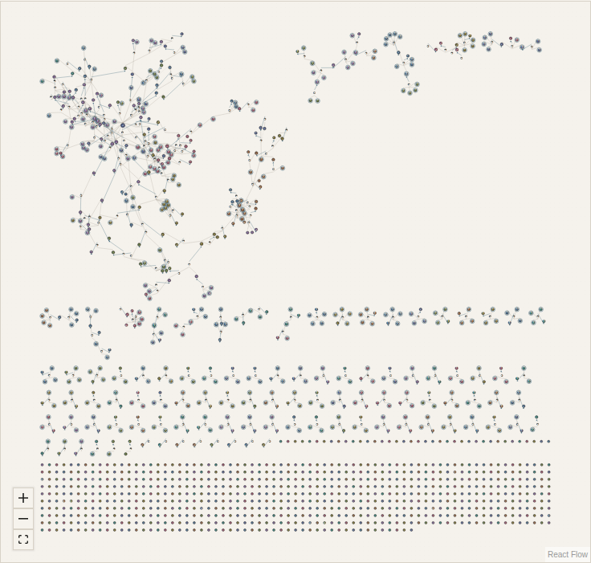
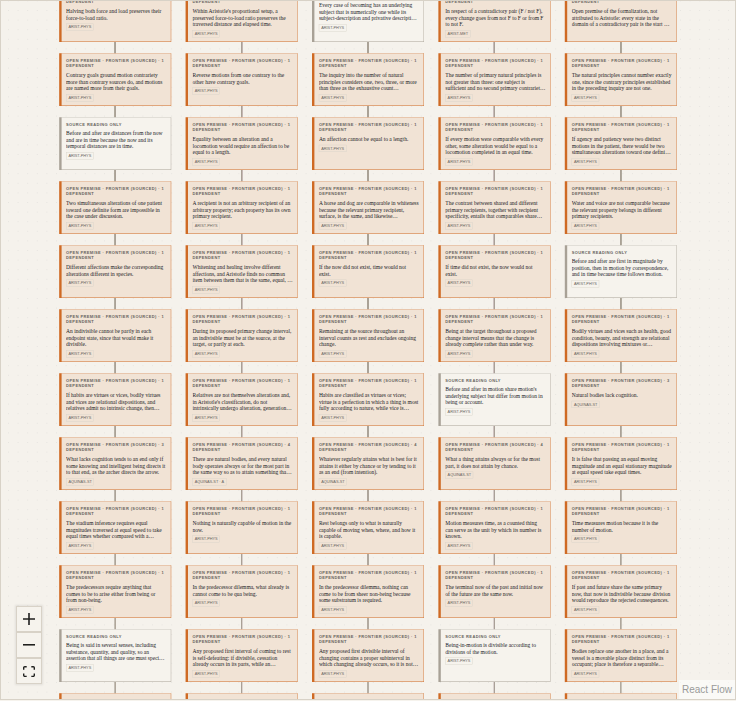
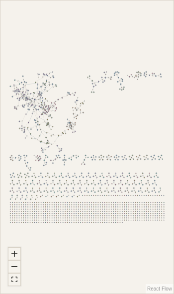
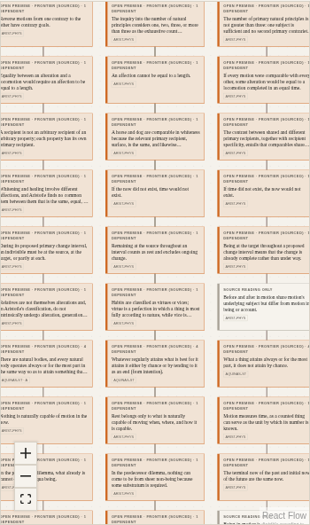

# Network overview acceptance (#221)

The graph uses the existing proposition projection and React Flow renderer. A build-time, stopped D3 force simulation computes positions from the full bipartite statement/inference graph, with 180 ticks per connected component. Sorted IDs and D3's fixed seed make positions deterministic. Single-node islands bypass simulation. Selection, filters, relation overlays and queue changes reuse these positions. No browser simulation or continuous frame animation is scheduled.

Community colors come from eight bounded label-propagation passes over inference incidence only. Position, community and incident degree describe connectivity; they do not estimate truth, confidence or source fidelity. The existing authoritative frontier report still supplies closure and establishment. Every proof edge meets an explicit inference junction; focused cards show complete AND-premises, and the inspector distinguishes alternative supporting applications (OR).

Structural filters distinguish statements without supporting inferences, statements without consumer inferences, and canonical open frontier obligations. Nonmatches are dimmed or hidden under the existing filter policy; counts distinguish outside-view from context/dimmed statements. Dashed semantic relations require an explicit overlay toggle and never influence layout or closure.

## Reproduce

From `apps/corpus-explorer` after `bun install --frozen-lockfile`:

```sh
bun run typecheck
bun run test
bun run lint
bun run build
NETWORK_SCREENSHOTS="$PWD/../../docs/evidence/network-221" bun run test:browser
GITHUB_PAGES=true bun run build
TEST_BASE_PATH=/truth-core bun run test:browser
```

Use the repository's heavy-command lock for installation and builds. On memory-constrained machines, limit Next's local static workers; this evidence used one static worker. The browser harness serves the actual static export, including `/truth-core` when requested, with no mocked corpus or API. Screenshots compare the same corpus in network and fully expanded layered modes at 1440×1000 and touch-enabled 390×844 viewports. The original reference image was not attached to the issue; these are behavior/composition comparisons, not a pixel-match claim.

The deterministic budget is 180 build-time ticks per nontrivial component, eight community passes, zero browser layout ticks, one marker per visible typed node, and viewport culling. Browser tests exercise selection and queue synchronization, keyboard Enter, touch tap, zoom/wheel viewport navigation, focused AND/OR detail and return, and unchanged node positions after settling. Existing frontier tests additionally cover scope, reload and restored viewport. Local wall-clock observations are informational on this shared machine, not CI regression thresholds.

## Local observations

The corpus at the starting revision `53df5e6` contains 1,319 statements and 237 inference applications in 833 inference-connected components. The focused unit workload took 604 ms to compute its complete layout. Browser observations on Linux 7.0.0-38-generic, Node 24.16.0 and Bun 1.4.3 were 1,559 ms to mount the desktop overview and 1,391 ms for queue selection; touch-mobile emulation took 1,651 ms and 762 ms respectively. Both mounted 1,556 typed nodes in the initial fitted viewport. These are single local observations, not a claim about physical-device or deployed latency. The browser test emits workload, browser/runtime versions, node count and timing for repeat measurements. The practical local targets are under five seconds for initial overview and under two seconds for selection; shared CI reports timing without a noisy wall-clock gate.

The eight community fill colors have white-symbol WCAG contrast ratios from 5.35:1 to 6.35:1; ink outlines and distinct symbols/rings preserve non-color distinctions across themes. Labels use the application's paper/ink tokens.

## Screenshots

| Viewport | Network | Expanded layered comparison |
| --- | --- | --- |
| Desktop |  |  |
| Touch mobile |  |  |

No source claims, statements, proof terms, definition links or disambiguations changed. The self-sweep checked the UI's formal-consequence limits, inference/AND/OR wording and continued separation of topology, source interpretation, closure and establishment. This change does not close a philosophical frontier node. Deployed Pages acceptance remains an explicit post-merge check; #221 stays open until that check is recorded.

Shared convention `sourceRevision`: `c104800c7aaeaea12d56f9093e71bdef6a2ce6fa`.
