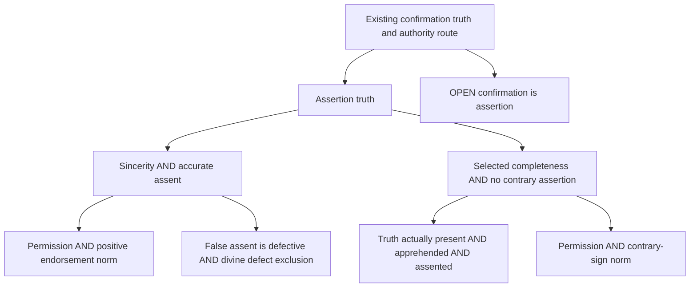

# Divine veracity: conditional assertion routes (#1410)

Complete proposed outcome for independent semantic challenge, 2026-11-11.
Baseline e02bd650; final delivered revision is the PR head. This note records
analyst reconstructions, not source-attributed corpus claims or established premises.

## Target, meaning and reuse

The target is `GodAssertsOnlyTruth`: every proposition genuinely asserted on its
own word by one GOD_4 with classical attributes is true. The common connection
is existing `ConfirmingIsAsserting` (b426b086-1b1c-5137-94e6-a2f17402481f)
and exact `GodConfirmsOnlyTruth` (c1deb2ee-770d-5030-9e5c-302e33028811),
then the existing authority route toward the Catholicism root. The confirmation
bridge remains OPEN. This does not establish a historical message as divine.

Reuse inventory: `related ad56f066`, dossiers for ad56f066, 7cffee54, 4d47d4ae,
b426b086, c1deb2ee, and context 922ad771 inspected at baseline. Existing
`NamingVeracityBatch1.Veracity`, `Signature`, GOD_4 and the old theorem route
are unchanged. Knows means holds-as-known and remains nonfactive. A distinct
assent-to-held-known bridge recovers 4d47d4ae and 7cffee54; neither implies
ad56f066. No imported theorem family is duplicated.

**Representation boundary.** The inherited attitudes have type `Being → Prop → Prop`:
this is an **extensional truth-value-level abstraction**. With propositional
extensionality, logically equivalent contents are identical; classically all
true propositions are equivalent to True and all false ones to False. The
formalism therefore cannot distinguish selective assent, assertion or
presentation among co-true contents (or among co-false contents). Full
truth-completeness in this encoding must not be advertised as capturing
individuated omniscient cognition. Transfer to individuated assertoric and
cognitive contents is a separate **OPEN** representation bridge throughout the
graph, shared by the inherited route and these alternatives. A future richer
content type with a truth interpretation would require fresh binding and
semantic review; no such transfer is proved here.

All propositions concern the same speaker, attitude and fixed context. The
unrestricted scope is Lean Prop, including negations and contingent claims;
there is no world/time quantification. These are actual assertions, not power
to assert falsely, necessary immunity, unrestricted nondeception, or permission
of creaturely error. Quotation, metaphor and fiction need correct content
identification before an instance is licensed. True selective assertions may
mislead; that stronger issue is outside this target.

## Formal graph and exact open inputs

Each AND box is a joint sufficient bundle; A and B are alternatives. Edges mean
conditional derivation only, never independent warrant or established truth.
Route A composes Asserts→Believes→truth constructively. Route B obtains a
contradiction from a false assertion and actual assent to its true negation,
then uses classical double-negation elimination. It assumes neither sincerity
nor general consistency. Its **weakest employed completeness** is
`GodCounterAssertionComplete`: Asserts(g,p)→¬p→Believes(g,¬p).
`GodTruthComplete` is the stronger sibling; the sole-premise theorem
`completenessWeakens` certifies the registered strengthens relation. Full
completeness is retained for the separate general-accuracy argument with
consistent assent. It is not imposed on the minimal B argument.

The lower branches expose independently disputable steps rather than extracting
moral or cognitive omniperfection from the primitive HasClassicalAttributes.
Permission applicability plus a positive endorsement norm yields sincerity;
permission plus a contrary-sign prohibition yields no contrary assertion;
false-assent defect plus exclusion of cognitive defects yields accuracy
(classically); actual truth-presence, apprehension and assent yield full
completeness constructively. Each lower antecedent remains OPEN.

## Selected primary passages read and philosophical support

The following pages and named passages were read on 2026-11-11. These are
navigation plus examined reasoning in this note, not newly pinned source
records. No source-host availability is a recurring verification condition.

[Aquinas, SCG I](https://isidore.co/aquinas/english/ContraGentiles1.htm),
61 §§3–8 and 93 §§1–3,8–10: the former offers proper-object, intellectual-virtue,
and truth-as-cognitive-good arguments against error; the latter transfers
nonpassional active virtues and truthful manifestation to divine intellect/will,
while excluding imperfect modes. This supports investigating error as defect
and truthful assertion as appropriate perfection. It does not establish that
our GOD_4 bearer has these perfections or that every prop-indexed assent is
covered. Non-discursiveness blocks one error channel, not every false assent.
The virtue argument needs a reason why this act counts as an intellectual
defect and why the perfection is appropriate to that bearer; our two open
premises retain those burdens. Unlike a factive definition, they can fail
independently in interpretations.

[Aquinas, ST II–II q.110](https://www.newadvent.org/summa/3110.htm), a.1 and
a.3 body, objection/reply 4 and reply 6: the argument evaluates assertoric signs
by their relation to the speaker's thought, and rejects rectifying a disordered
act by a beneficial further end. Withholding and figurative content are treated
separately. This gives a reason for ContraryAssertionImpermissible rather than
merely naming goodness. Its exceptionlessness and analogical application remain
contested. A negative lie prohibition does not alone exclude suspension;
PermittedAssertionEndorsed is a stronger OPEN norm. A possible defense is that
putting p forward on one's own authority undertakes an endorsement commitment;
the missing step is why this commitment requires actual assent, rather than
only proper evidence or willingness to answer challenges. We have not hidden
that inference in Asserts's definition.

[Aquinas, ST I q.14](https://www.newadvent.org/summa/1014.htm), aa.1,5–6,
13–14: the immateriality and self-knowledge arguments concern cognitive scope
and proper creaturely content. Article 13 additionally invokes eternal access
to actual contingents, distinguishing them from undetermined causes. Article
14 treats enunciations without imposing discursive composition. These motivate
separate actuality, access and content-to-assent burdens. Knowledge of possible
effects does not settle which free contingent occurs; representation of an
enunciation is not assent to its truth. The intended Apprehends reading concerns an obtaining content, but its
extensional encoding does not capture individuation or selective presentation.
Even after that OPEN representation transfer, the general bridge
ApprehensionAssented is still OPEN: an interpreter must justify why presentation
here is judgment-ready. One can deny that bridge while allowing presentation.
No claim that immateriality alone proves actual truth-completeness is made.

[Aquinas, ST I q.4](https://www.newadvent.org/summa/1004.htm), aa.1–2,
argues from the first active principle's actuality and causal perfection.
The step from causal perfection to the selected moral/cognitive acts is OPEN;
repository IsPerfect and causal IsSupremelyGood cannot replace it.

## Strongest surviving rival and its further commitments

[Hobbes, Third Objections XV; Descartes's reply](https://www.gutenberg.org/cache/epub/70091/pg70091-images.html#Page_152)
(Molyneux translation, printed pp.152–153) challenges unrestricted nondeception
using beneficial parental and medical deception, locating fault in injury.
The reply limits the required immunity to error implying a will incompatible
with divine nature. It does not itself supply our exceptionless assertion norm.

The strongest relevant analyst rival combines accurate and actually complete
cognition with a permission to assert a known falsehood when this uniquely
protects another's good. It need not deny intellectual perfection. Its positive
account is that communication serves rational agency or welfare, whose total
demands can override sincere signification. To apply this to GOD_4 it must show
that the asserted falsehood is a fitting act of that bearer, explain why
withholding, truthful alternatives or superior nondeceptive means cannot do the
same job, and delimit when an audience may rely on assertion. These are costs
and research questions, not demonstrated contradictions. No accepted floor
item here independently excludes them. Conversely, mere availability of
withholding does not prove it always protects the same goods; the absolutist
reply still needs its act-object argument. A further rival challenges positive
endorsement while preserving no-contrary assertion: assertion during suspended
judgment, perhaps on sufficient evidence, need not be lying. This threatens A's
sincerity route while leaving B's distinct requirements available.

## Controls, rejected shortcuts and model boundaries

`controls` proves a joint sample of all lower branches with an existing
classified God bearer and genuine assertion of True. The sample uses truth
matching as an interpretation, not as a mechanism or independent explanation.
It proves nonvacuity of the encoded bundle only.

Four omissions retain one A/B input while allowing an asserted False. Models
use truthful attitudes without sincere assertion, indiscriminate sincere
attitudes without accuracy, and suspended attitudes without completeness.
The truth-complete omission sample also satisfies general accurate and
consistent assent, so cognitive perfection alone does not exclude the false
assertion. The fifth sample has no contrary assent but lacks sincerity.
A separate permission sample gives complete accurate consistent cognition and
permits false assertion when the contrary-sign norm is removed. Benefit, utility,
complete divine metaphysics and modal possibility are absent: it is a structural
surrogate of the normative gap, not proof that benevolent divine lying is possible.

Rejected shortcuts: factivity from the name Knows; extracting ethics from
HasClassicalAttributes; no-lie→positive sincerity; non-discursive→all-error-free;
possible-effect cognition→actual contingents; presenting a sentence→assenting
to its content; and institutional doctrine→independent warrant for that
institution's authority. Existing #1380's relational discrimination results
show why actual-content distinctions matter, but its factive relational Knows
is not this nonfactive Knows. No cross-vocabulary inference is licensed here.

## Provisional assessment and next discriminating work

Conditional consequence is supported by the Lean artifacts. Overall warrant
remains **underdetermined at the moral and divine-applicability bridges**.
The lower argument tree is more informative than an opaque perfection premise:
its sign-function reasoning and cognitive-defect reasoning offer different
reasons, with distinct failure points. They are not independent corroboration
where they share divine-perfection applicability. B has a smaller sincerity
burden but requires its selected countertruth attitude in the formal abstraction;
a genuine actual-countertruth cognition burden appears only after the OPEN
individuated-content transfer. Neither route is
currently shown better warranted overall. Beneficial deception is not defeated.
No independent philosophical warrant or fully grounded establishment is supplied
for these premises, ad56f066, historical revelation or the Catholicism root.
The computed legacy classification nevertheless changes 7cffee54 from
supported to closed because the new result concludes it conditionally; its
sincerity and assent-to-held-known dependencies remain OPEN. This computed
closure is distinct from independent warrant and fully grounded establishment.

Strengthen this assessment by defending the assertion norm against the strongest
welfare/agency case and showing its divine applicability without assuming the
authority conclusion; weaken it if a fitting beneficial false divine assertion
survives. A concrete next test is an act-object comparison with truthful and
withholding alternatives held fixed, distinguishing constitutive assertion norms
from defeasible audience interests. For cognition, test actual contingent access
under the same bearer and content representation; suspend the completeness
route if presentiality cannot discriminate actuality or if the translation to
assent fails. These are reassessment directions, not proof-search exhaustion.

## Claim/type self-sweep and service experiment

Every theorem's hypotheses and conclusion use the same Signature and Veracity;
the root connection specializes the existing Agency bridge. Frozen Challenges
retain exact signatures. Classical reasoning is explicit in B, completeness plus
consistency and defect exclusion. No axiom declares divine truthfulness. Controls
certify only their stated extensional structural interpretations. The computed premise delta
belongs in the PR evidence; new connected options are not floor discharge.

Service experiment at clean preview e02bd650, continuation-1111:
ordinary Solution submission failed because the preview lacks the new vocabulary
import. A combined full-text submission importing only the existing baseline
vocabulary elaborated successfully; a second edit reused the session. This
preserves the preview and tests diagnostics but is not final module verification.
Corpus dossier calls use existing semantics. Retain the service for repeated
edits with loaded imports; revise dependency refresh support for new modules.
Canonical CLI build remains necessary. Timings and content hashes are retained
in the PR check evidence; no throughput conclusion follows from this sample.

## Individuated-content continuation: complete proposed outcome

**Status:** new proposed continuation, separate from PR #1412's accepted
extensional checkpoint. Definitions/results in `DivineVeracityContent1410`
and spec `specs/divine-veracity-content-1410.toml`; independent semantic challenge
and final delivered-head gates remain required. No historical attribution changes.

### Question, reuse and restored commitments

Does the repaired representation limit prevent the assertion-truth routes from
working when cognitive contents retain identity independently of truth values?
This serves the existing assertion-truth target 5a035a1e and its confirmation /
authority root route. Inventory refreshed: related/dossier 5a035a1e and e2ca9054,
contexts d1fb84b0 and aa79e774, dossiers 1496f7ec, 7dd8a624 and 6e8807d4.
Existing `ReflectiveCoherence.Semantics` already separates a content type from
its truth interpretation at worlds and supplies interpreted negation. Reuse
that exact structure and `SelfApplication.Disquotes`; do not introduce another
truth or negation calculus. Existing common-knower and truth-pilot vocabulary
was inspected; it does not already encode the assertion-truth route or its
legacy representation issue. Existing frozen proofs and definitions stay intact.

New `Attitudes σ Content` has primitive genuine assertion and actual assent to
one **identical content**, in a fixed context. No invariance under truth or
logical equivalence is assumed. `World` and `Content` remain arbitrary; the
actual valuation world is an explicit parameter. The new predicates do not
supply a theory of mental representation or establish that an event is a divine
assertion. Same-content identity is explicit; faithful application to actual
psychological or divine contents remains OPEN. The generic framework permits
selectivity even between semantically equivalent contents.

### Consequences and exact hypotheses

| Consequence | Joint sufficient hypotheses | Boundary |
|---|---|---|
| Content assertions true, Route A | Sincerity to that content; accuracy on D; every actual assertion lies in D | Constructive; accuracy outside D is unnecessary |
| Content assertions true, Route B | Actual assent to each true negated content of an actual assertion; no contrary assertion | Classical; uses the reused negation truth law; no positive sincerity |
| Selected countercompleteness | Actual truth-completeness on D; every assertion in D; D closed under interpreted negation | Constructive; domain choice itself supplies neither coverage bridge |
| Existing legacy assertion truth 5a035a1e | Content assertion truth; every relevant legacy assertion represented by an asserted content with one-way disquotation | Constructive; representation applicability remains OPEN |
| Erasure has assertion representation | Explicit existential-erasure construction | Only its induced legacy V, not every arbitrary V |

This removes the need to collapse contents into `Prop` **within the conditional
routes**. It does not discharge their moral/cognitive premises or the legacy
representation bridge. The existing lower Prop-indexed norm/defect/presence
results cannot silently be reused as content-attitude premises: their transfer
must be proved or the corresponding philosophical reasons separately applied
at this content level. No such transfer or independent warrant is claimed here.

### Discriminating models, failed translation and further rival commitments

The control content type is `Bool × Bool × Bool`. Two coordinates give truth
at two modeled worlds; an independent third tag keeps content identities
separate. Negation flips the truth coordinates and preserves the identity tag.
At designated world false, `a=(true,false,false)` and `b=(true,false,true)` are
both true; indeed their truth conditions agree at **every** modeled world.
The sample assents to and asserts only a. The tag models a distinction in
representation without claiming that it is an adequate account of mental
content individuation. A and B hold together; D contains a and its negation,
so its completeness is nonvacuous and negation-closed. The other true content b
is outside D and unassented. Thus selected completeness here is not global
omniscience. The content a is false at the other modeled world; this is
valuation variation, not an established claim of metaphysical contingency.

`NoExactLegacyTranslation` proves that **no** legacy `Veracity` has a Believes
relation agreeing exactly with this sample's assent on every content under the
map `c ↦ trueAt false c`. Propositional extensionality identifies the two equal
truth conditions, but selective assent distinguishes their tagged contents.
The no-translation result is universal over legacy V for this fixed witness;
it does not deny that some other content-attitude profiles are extensional.
Consequently exact recovery is not merely an unproved bridge for this sample:
it is incompatible with its selectivity. A source argument requiring different
access to equivalent contents cannot be represented by asserting such an exact
legacy map. Its weakest assertion-preserving connection can still succeed.

The explicit erasure instead sets legacy assertion/assent to **existence of
some** asserted/assented content with the given truth condition. It forgets
which content supplied the attitude, so can attribute the erased attitude to b's
truth condition despite lack of assent to b. Its one-way representation theorem
is valid but must not be described as faithful recovery of all attitudes. For
an independently given legacy V, `AssertionRepresentation` remains an OPEN
coverage-and-disquotation input. Together with content assertion truth it
reaches the existing 5a035a1e target, and the already checked confirmation route
then connects to authority. The erasure diagnostic is not itself a new warrant
for identifying the case's given V with this induced one.

A Route B suspension sample asserts the true a while assenting to no content;
it satisfies B and truth but not sincerity. This distinguishes the route's
logical requirements in the restored semantics, without defending the morality
of unsupported assertion.

The strongest cognitive rival is also restored: assent to **all true tagged
contents**, accurate and negation-consistent, together with actual assertion
of the false negation of a. It refutes content assertion truth while preserving
these cognitive conditions. This does not model utility, moral permission,
divine moral perfection, full classical attributes or a historical possibility.
It establishes that restoring individuated content and truth variation does
not make the normative gap disappear. The welfare/agency rival from the prior
section therefore cannot be dismissed by appealing only to cognitive perfection;
its positive ethical defense and divine applicability remain unanswered.

Two scope omission samples use an actually false assertion with no contrary
assent. If D includes only that false content, completeness on D and assertion
coverage hold but negation closure fails; if D is empty, completeness and
negation closure hold but assertion coverage fails. In both cases selected
countercompleteness and assertion truth fail. Neither vacuous domain completeness
nor a domain name licenses the missing actual countertruth judgment.

### Provisional assessment, exact remaining gaps and reopening

The hypothesis that A/B require truth-value collapse is **rejected for these
conditional routes**: their preserved-content derivations and selective joint
sample supply direct evidence. The stronger claim that the inherited legacy
attitudes can exactly preserve selective assent under truth-condition erasure
is **refuted for the exhibited witness**, not globally for every attitude profile.
The result supports a one-way assertion representation connection while
withholding full cognitive translation. Neither route is better warranted
philosophically merely because it has a content-preserving proof.

Moral exceptionlessness, actual cognitive access, same-bearer divine
applicability, meaningful content individuation and historical assertion
identification remain OPEN. The positive lower reasons from SCG/ST remain
philosophical reasons to assess; new content types do not strengthen their
independent warrant. Reopen the route if its intended negation is not the
interpreted negation, its actual assertions exceed D, or D omits their required
negations. Reopen the legacy connection if a relevant proposition assertion
has no correctly disquoting represented content.

The next consequential question is now the act-object norm: under what account
of genuine assertion does an audience's welfare or rational agency license an
intentional false assertion, and is that account fitting for the same GOD_4?
Distinguish an undertaking of responsibility from an actual-assent requirement;
otherwise the moral conclusion is hidden in the assertion definition. A concrete
comparison should hold actual speaker, content, available truthful/withholding
alternatives and audience good fixed, and identify why one option is forbidden
or permitted. No new witness or accepted floor currently settles that comparison.
The content result narrows the representation obstacle without answering this
normative question. It does not show the bounded philosophical question exhausted.
