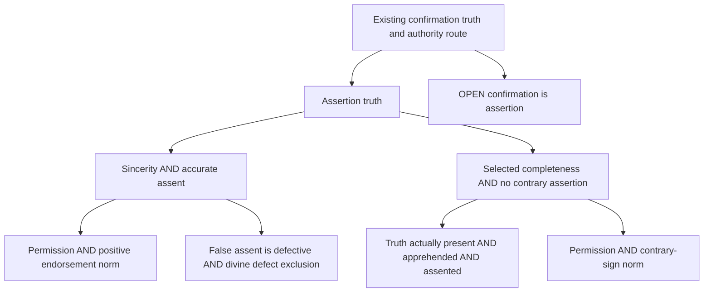

# Divine veracity: conditional assertion routes (#1410)

Complete proposed outcome for independent semantic challenge, 2026-11-11.
Baseline e02bd650; final delivered revision is the PR head. This note records
analyst reconstructions, not source-attributed corpus claims or established premises.

## Target, meaning and reuse

The target is `GodAssertsOnlyTruth`: every proposition genuinely asserted on its
own word by one GOD_4 with classical attributes is true. The common connection
is existing `ConfirmingIsAsserting` (b426b086-1b1c-5137-94e6-a2f17402481f)
and exact `GodConfirmsOnlyTruth` (c1deb2ee-770d-5030-9e5c-302e33028811),
then the existing authority route toward the Catholicism root. The confirmation
bridge remains OPEN. This does not establish a historical message as divine.

Reuse inventory: `related ad56f066`, dossiers for ad56f066, 7cffee54, 4d47d4ae,
b426b086, c1deb2ee, and context 922ad771 inspected at baseline. Existing
`NamingVeracityBatch1.Veracity`, `Signature`, GOD_4 and the old theorem route
are unchanged. Knows means holds-as-known and remains nonfactive. A distinct
assent-to-held-known bridge recovers 4d47d4ae and 7cffee54; neither implies
ad56f066. No imported theorem family is duplicated.

All propositions concern the same speaker, attitude and fixed context. The
unrestricted scope is Lean Prop, including negations and contingent claims;
there is no world/time quantification. These are actual assertions, not power
to assert falsely, necessary immunity, unrestricted nondeception, or permission
of creaturely error. Quotation, metaphor and fiction need correct content
identification before an instance is licensed. True selective assertions may
mislead; that stronger issue is outside this target.

## Formal graph and exact open inputs

Each AND box is a joint sufficient bundle; A and B are alternatives. Edges mean
conditional derivation only, never independent warrant or established truth.
Route A composes Asserts→Believes→truth constructively. Route B obtains a
contradiction from a false assertion and actual assent to its true negation,
then uses classical double-negation elimination. It assumes neither sincerity
nor general consistency. Its **weakest employed completeness** is
`GodCounterAssertionComplete`: Asserts(g,p)→¬p→Believes(g,¬p).
`GodTruthComplete` is the stronger sibling; the sole-premise theorem
`completenessWeakens` certifies the registered strengthens relation. Full
completeness is retained for the separate general-accuracy argument with
consistent assent. It is not imposed on the minimal B argument.

The lower branches expose independently disputable steps rather than extracting
moral or cognitive omniperfection from the primitive HasClassicalAttributes.
Permission applicability plus a positive endorsement norm yields sincerity;
permission plus a contrary-sign prohibition yields no contrary assertion;
false-assent defect plus exclusion of cognitive defects yields accuracy
(classically); actual truth-presence, apprehension and assent yield full
completeness constructively. Each lower antecedent remains OPEN.

## Selected primary passages read and philosophical support

The following pages and named passages were read on 2026-11-11. These are
navigation plus examined reasoning in this note, not newly pinned source
records. No source-host availability is a recurring verification condition.

[Aquinas, SCG I](https://isidore.co/aquinas/english/ContraGentiles1.htm),
61 §§3–8 and 93 §§1–3,8–10: the former offers proper-object, intellectual-virtue,
and truth-as-cognitive-good arguments against error; the latter transfers
nonpassional active virtues and truthful manifestation to divine intellect/will,
while excluding imperfect modes. This supports investigating error as defect
and truthful assertion as appropriate perfection. It does not establish that
our GOD_4 bearer has these perfections or that every prop-indexed assent is
covered. Non-discursiveness blocks one error channel, not every false assent.
The virtue argument needs a reason why this act counts as an intellectual
defect and why the perfection is appropriate to that bearer; our two open
premises retain those burdens. Unlike a factive definition, they can fail
independently in interpretations.

[Aquinas, ST II–II q.110](https://www.newadvent.org/summa/3110.htm), a.1 and
a.3 body, objection/reply 4 and reply 6: the argument evaluates assertoric signs
by their relation to the speaker's thought, and rejects rectifying a disordered
act by a beneficial further end. Withholding and figurative content are treated
separately. This gives a reason for ContraryAssertionImpermissible rather than
merely naming goodness. Its exceptionlessness and analogical application remain
contested. A negative lie prohibition does not alone exclude suspension;
PermittedAssertionEndorsed is a stronger OPEN norm. A possible defense is that
putting p forward on one's own authority undertakes an endorsement commitment;
the missing step is why this commitment requires actual assent, rather than
only proper evidence or willingness to answer challenges. We have not hidden
that inference in Asserts's definition.

[Aquinas, ST I q.14](https://www.newadvent.org/summa/1014.htm), aa.1,5–6,
13–14: the immateriality and self-knowledge arguments concern cognitive scope
and proper creaturely content. Article 13 additionally invokes eternal access
to actual contingents, distinguishing them from undetermined causes. Article
14 treats enunciations without imposing discursive composition. These motivate
separate actuality, access and content-to-assent burdens. Knowledge of possible
effects does not settle which free contingent occurs; representation of an
enunciation is not assent to its truth. Our Apprehends concerns the actual
obtaining content rather than entertaining either side. The general bridge
ApprehensionAssented is still OPEN: an interpreter must justify why presentation
here is judgment-ready. One can deny that bridge while allowing presentation.
No claim that immateriality alone proves actual truth-completeness is made.

[Aquinas, ST I q.4](https://www.newadvent.org/summa/1004.htm), aa.1–2,
argues from the first active principle's actuality and causal perfection.
The step from causal perfection to the selected moral/cognitive acts is OPEN;
repository IsPerfect and causal IsSupremelyGood cannot replace it.

## Strongest surviving rival and its further commitments

[Hobbes, Third Objections XV; Descartes's reply](https://www.gutenberg.org/cache/epub/70091/pg70091-images.html#Page_152)
(Molyneux translation, printed pp.152–153) challenges unrestricted nondeception
using beneficial parental and medical deception, locating fault in injury.
The reply limits the required immunity to error implying a will incompatible
with divine nature. It does not itself supply our exceptionless assertion norm.

The strongest relevant analyst rival combines accurate and actually complete
cognition with a permission to assert a known falsehood when this uniquely
protects another's good. It need not deny intellectual perfection. Its positive
account is that communication serves rational agency or welfare, whose total
demands can override sincere signification. To apply this to GOD_4 it must show
that the asserted falsehood is a fitting act of that bearer, explain why
withholding, truthful alternatives or superior nondeceptive means cannot do the
same job, and delimit when an audience may rely on assertion. These are costs
and research questions, not demonstrated contradictions. No accepted floor
item here independently excludes them. Conversely, mere availability of
withholding does not prove it always protects the same goods; the absolutist
reply still needs its act-object argument. A further rival challenges positive
endorsement while preserving no-contrary assertion: assertion during suspended
judgment, perhaps on sufficient evidence, need not be lying. This threatens A's
sincerity route while leaving B's distinct requirements available.

## Controls, rejected shortcuts and model boundaries

`controls` proves a joint sample of all lower branches with an existing
classified God bearer and genuine assertion of True. The sample uses truth
matching as an interpretation, not as a mechanism or independent explanation.
It proves nonvacuity of the encoded bundle only.

Four omissions retain one A/B input while allowing an asserted False. Models
use truthful attitudes without sincere assertion, indiscriminate sincere
attitudes without accuracy, and suspended attitudes without completeness.
The truth-complete omission sample also satisfies general accurate and
consistent assent, so cognitive perfection alone does not exclude the false
assertion. The fifth sample has no contrary assent but lacks sincerity.
A separate permission sample gives complete accurate consistent cognition and
permits false assertion when the contrary-sign norm is removed. Benefit, utility,
complete divine metaphysics and modal possibility are absent: it is a structural
surrogate of the normative gap, not proof that benevolent divine lying is possible.

Rejected shortcuts: factivity from the name Knows; extracting ethics from
HasClassicalAttributes; no-lie→positive sincerity; non-discursive→all-error-free;
possible-effect cognition→actual contingents; presenting a sentence→assenting
to its content; and institutional doctrine→independent warrant for that
institution's authority. Existing #1380's relational discrimination results
show why actual-content distinctions matter, but its factive relational Knows
is not this nonfactive Knows. No cross-vocabulary inference is licensed here.

## Provisional assessment and next discriminating work

Conditional consequence is supported by the Lean artifacts. Overall warrant
remains **underdetermined at the moral and divine-applicability bridges**.
The lower argument tree is more informative than an opaque perfection premise:
its sign-function reasoning and cognitive-defect reasoning offer different
reasons, with distinct failure points. They are not independent corroboration
where they share divine-perfection applicability. B has a smaller sincerity
burden but pays an actual-countertruth cognition burden; neither route is
currently shown better warranted overall. Beneficial deception is not defeated.
No premise, ad56f066, historical revelation or Catholicism root is established.

Strengthen this assessment by defending the assertion norm against the strongest
welfare/agency case and showing its divine applicability without assuming the
authority conclusion; weaken it if a fitting beneficial false divine assertion
survives. A concrete next test is an act-object comparison with truthful and
withholding alternatives held fixed, distinguishing constitutive assertion norms
from defeasible audience interests. For cognition, test actual contingent access
under the same bearer and content representation; suspend the completeness
route if presentiality cannot discriminate actuality or if the translation to
assent fails. These are reassessment directions, not proof-search exhaustion.

## Claim/type self-sweep and service experiment

Every theorem's hypotheses and conclusion use the same Signature and Veracity;
the root connection specializes the existing Agency bridge. Frozen Challenges
retain exact signatures. Classical reasoning is explicit in B, completeness plus
consistency and defect exclusion. No axiom declares divine truthfulness. Controls
certify only their stated structural interpretations. The computed premise delta
belongs in the PR evidence; new connected options are not floor discharge.

Service experiment at clean preview e02bd650, continuation-1111:
ordinary Solution submission failed because the preview lacks the new vocabulary
import. A combined full-text submission importing only the existing baseline
vocabulary elaborated successfully; a second edit reused the session. This
preserves the preview and tests diagnostics but is not final module verification.
Corpus dossier calls use existing semantics. Retain the service for repeated
edits with loaded imports; revise dependency refresh support for new modules.
Canonical CLI build remains necessary. Timings and content hashes are retained
in the PR check evidence; no throughput conclusion follows from this sample.
