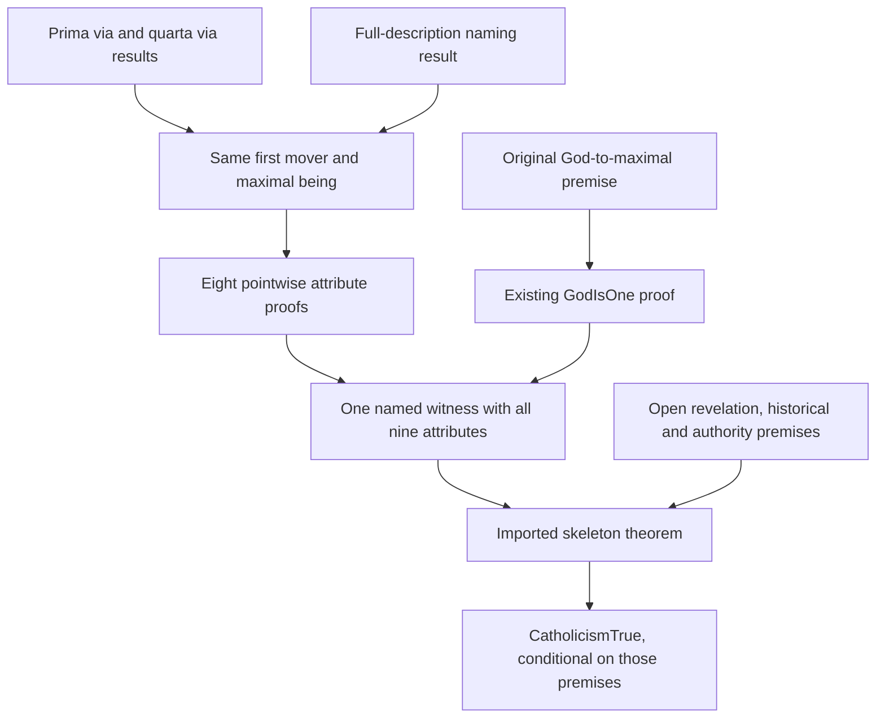

# Connecting stages 1 and 2 to the Catholic skeleton

The designated root proof is now
`CATHOLICISM-FROM-PRIMA-VIA-WITH-CLASSICAL-ATTRIBUTES`. Its Lean theorem derives
`STMT-CATHOLICISM-TRUE` from the existing philosophical and historical premises;
it does not establish their truth. The previous root results and their frozen
Challenges remain available.

Previously the root theorem imported the First Way and Stage1 full-description
proof, then accepted `STMT-GOD-HAS-CLASSICAL-DIVINE-ATTRIBUTES` as a separate
input. The frontier already expanded that input through Stage2. The new proof
makes that connection inside Lean, retaining the same being through both stages.

The diagram summarizes two verified-result records; it adds no inference by
itself:

| Result | Consumed results | Conclusion |
| --- | --- | --- |
| `CATHOLICISM-STAGES-ONE-TWO-SAME-WITNESS` | `PrimaVia.primaVia`, `QuartaVia.quartaVia`, `MaximeEnsIsGodViaFullDescription.maximeEnsIsGodViaFullDescription`, `FirstMoverIsMaximeEns.firstMoverIsMaximeEns`, the nine `StageTwo.God…` proofs | `UniqueClassicalGodExists`: one being is God, is the only `IsGod` instance, and has classical attributes |
| `CATHOLICISM-FROM-PRIMA-VIA-WITH-CLASSICAL-ATTRIBUTES` | The same-witness result and `Skeleton.catholicismSkeleton` | The existing phase-1 Catholic root |

## Why the witness must remain the same

With the existing excluded-middle instance, the First Way supplies a first
unmoved mover. The Fourth Way supplies a maximal being. The existing identity theorem identifies them, and the full-description
naming theorem applies `IsGod` to that maximum. The new result retains this
maximality information, which the older Stage1 existential conclusion forgets.

The eight non-uniqueness attribute proofs are generic in their predicate. They
can be applied to maximal beings and then instantiated at the selected mover.
This internal instantiation does not replace the skeleton's `IsGod` predicate
with maximality. The ninth attribute uses the existing `GodIsOne` theorem and
its original `GodIsMaximalInBeing` premise.

The result packages the same witness with its God predicate, uniqueness and
attributes. Its uniqueness allows equality transport of those attributes to
any other `IsGod` instance, providing the universal input required by the
unchanged skeleton theorem. Separate existential claims about a God and about
an attributed being would not justify that step.

## The remaining naming gap

`GodNamesTheFullyDescribedPrinciple` is a sufficient description: a unique
maximum with the described causal and remoteness properties is God. It does not
say that every being satisfying `IsGod` is maximal. Likewise, uniqueness of
maxima excludes a second maximum, not a second nonmaximal `IsGod` instance.

The existing ninth attribute is `IsTheOneGod σ.IsGod g`: every original
`IsGod` instance equals `g`. Replacing it with uniqueness only among maxima
would change the meaning of the classical-attributes bridge. The connection
therefore retains `STMT-GOD-IS-MAXIMAL-IN-BEING` explicitly. The existing
`AQUINAS-NOMINAL-DESCRIPTION-OF-GOD-SUFFICES` candidate now records this precise
question for ST I q.13 aa.8–10; it cannot be answered by reversing the current
nominal premise or by using `GodIsOne` circularly.

## What changed and what remains open

The root theorem's independent attribute-bundle input has been discharged by
imported proofs, and the combined witness is an explicit intermediate statement.
The measured philosophical frontier is unchanged: **37 open premises, four bare
and 33 sourced**, with the same statement IDs before and after. This is proof
composition progress, not closure of a philosophical premise.

The Stage1/Stage2 causal, nominal and definitional assumptions remain open, as do
revelation, the historical stages 4–6, and the teaching-authority bridges. The
historical end is still the skeleton's structural transcription; composing it
does not verify source fidelity, premise truth or the Catholic conclusion
unconditionally.
