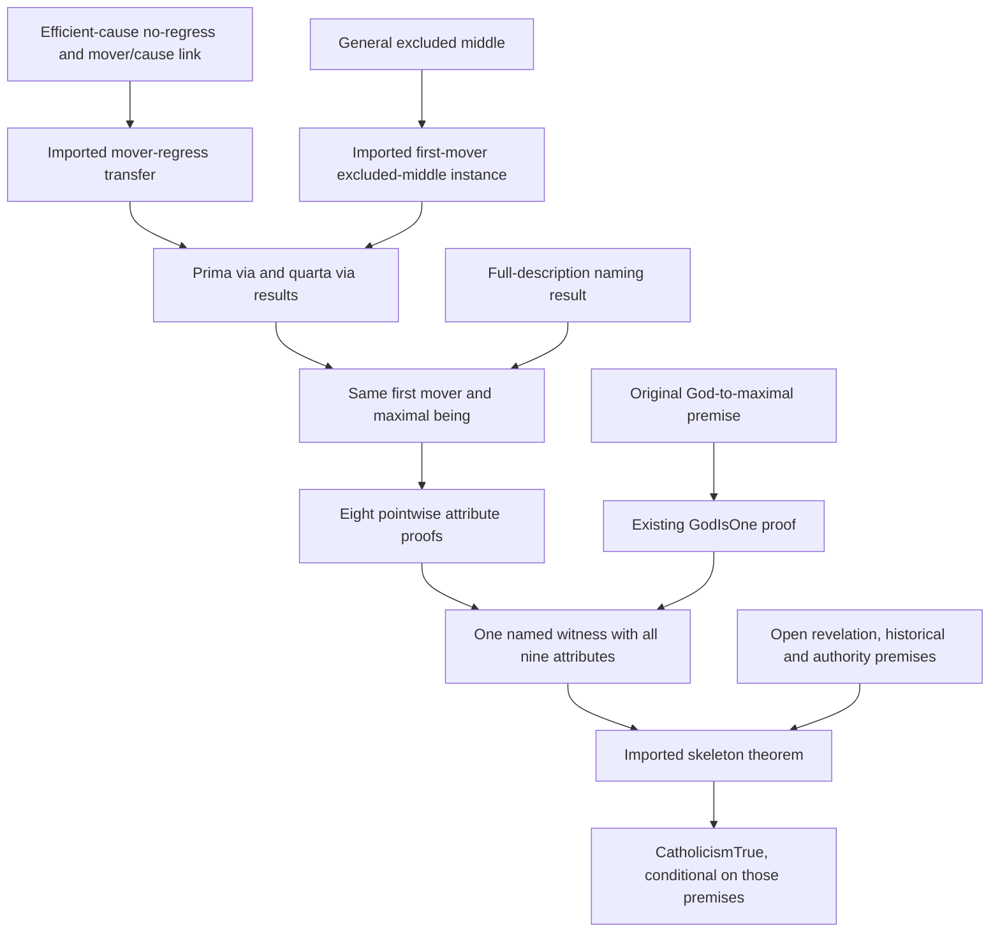

# Connecting stages 1 and 2 to the Catholic skeleton

The designated root proof is now
`CATHOLICISM-FROM-EFFICIENT-REGRESS-WITH-CLASSICAL-ATTRIBUTES`. Its Lean theorem derives
`STMT-CATHOLICISM-TRUE` from the existing philosophical and historical premises;
it does not establish their truth. The previous root results and their frozen
Challenges remain available.

Previously the root theorem imported the First Way and Stage1 full-description
proof, then accepted `STMT-GOD-HAS-CLASSICAL-DIVINE-ATTRIBUTES` as a separate
input. The frontier already expanded that input through Stage2. The new proof
makes that connection inside Lean, retaining the same being through both stages.

The diagram summarizes imported verified results; it adds no inference by
itself:

| Result | Consumed results | Conclusion |
| --- | --- | --- |
| `CATHOLICISM-STAGES-ONE-TWO-SAME-WITNESS` | `PrimaVia.primaVia`, `QuartaVia.quartaVia`, `MaximeEnsIsGodViaFullDescription.maximeEnsIsGodViaFullDescription`, `FirstMoverIsMaximeEns.firstMoverIsMaximeEns`, the nine `StageTwo.God…` proofs | `UniqueClassicalGodExists`: one being is God, is the only `IsGod` instance, and has classical attributes |
| `CATHOLICISM-FROM-PRIMA-VIA-WITH-CLASSICAL-ATTRIBUTES` | The same-witness result and `Skeleton.catholicismSkeleton` | The existing phase-1 Catholic root |

## Deriving the remaining proved inputs

The designated route now also imports
`MoverRegressFromCauseRegress.moverRegressFromCauseRegress` and
`FirstUnmovedMoverExistsOrNotFromEm.firstUnmovedMoverExistsOrNotFromExcludedMiddle`.
The first transfers accessibility from per se efficient-cause links to mover
links under their explicitly assumed inclusion. The second instantiates the
already-present general excluded-middle premise at first-mover existence.

`CATHOLICISM-FROM-EFFICIENT-REGRESS-WITH-CLASSICAL-ATTRIBUTES` then imports
`FromPrimaViaWithClassicalAttributes.catholicismFromPrimaViaWithClassicalAttributes`.
It does not duplicate the preceding same-witness or skeleton proofs. The four
existing inference-application records remain explicit in the composed argument.

The theorem no longer takes `STMT-NO-INFINITE-PER-SE-MOVER-SERIES` or
`STMT-FIRST-UNMOVED-MOVER-EXISTS-OR-NOT` as independent inputs. Its efficient-cause
no-regress and mover/cause-link premises were already in the philosophical
frontier, so this discharges proved theorem inputs rather than philosophical
assumptions. The frontier still has the same 37 open statement IDs (four bare,
33 sourced). Neither causal well-foundedness nor the link is established merely
by composing these results.

## Why the witness must remain the same

With the existing excluded-middle instance, the First Way supplies a first
unmoved mover. The Fourth Way supplies a maximal being. The existing identity theorem identifies them, and the full-description
naming theorem applies `IsGod` to that maximum. The new result retains this
maximality information, which the older Stage1 existential conclusion forgets.

The eight non-uniqueness attribute proofs are generic in their predicate. They
can be applied to maximal beings and then instantiated at the selected mover.
This internal instantiation does not replace the skeleton's `IsGod` predicate
with maximality. The ninth attribute uses the existing `GodIsOne` theorem and
its original `GodIsMaximalInBeing` premise.

The result packages the same witness with its God predicate, uniqueness and
attributes. Its uniqueness allows equality transport of those attributes to
any other `IsGod` instance, providing the universal input required by the
unchanged skeleton theorem. Separate existential claims about a God and about
an attributed being would not justify that step.

## The remaining naming gap

`GodNamesTheFullyDescribedPrinciple` is a sufficient description: a unique
maximum with the described causal and remoteness properties is God. It does not
say that every being satisfying `IsGod` is maximal. Likewise, uniqueness of
maxima excludes a second maximum, not a second nonmaximal `IsGod` instance.

The existing ninth attribute is `IsTheOneGod σ.IsGod g`: every original
`IsGod` instance equals `g`. Replacing it with uniqueness only among maxima
would change the meaning of the classical-attributes bridge. The connection
therefore retains `STMT-GOD-IS-MAXIMAL-IN-BEING` explicitly. The existing
`AQUINAS-NOMINAL-DESCRIPTION-OF-GOD-SUFFICES` candidate now records this precise
question for ST I q.13 aa.8–10; it cannot be answered by reversing the current
nominal premise or by using `GodIsOne` circularly.

## What changed and what remains open

The root theorem's independent attribute-bundle input has been discharged by
imported proofs, and the combined witness is an explicit intermediate statement.
The measured philosophical frontier is unchanged: **37 open premises, four bare
and 33 sourced**, with the same statement IDs before and after. This is proof
composition progress, not closure of a philosophical premise.

The Stage1/Stage2 causal, nominal and definitional assumptions remain open, as do
revelation, the historical stages 4–6, and the teaching-authority bridges. The
historical end is still the skeleton's structural transcription; composing it
does not verify source fidelity, premise truth or the Catholic conclusion
unconditionally.

## A distinct Fourth-Way alternative

`CATHOLICISM-FROM-QUARTA-VIA-WITH-CLASSICAL-ATTRIBUTES` is an alternative,
not the selected `root_route`. It imports `QuartaVia.quartaVia` to obtain the
maximal being directly from its four existing premises: actual grades,
approach to a maximum, maximal truth implying maximal being, and the
maximum-in-a-genus causal principle. No maximum-existence assumption is hidden
in a definition. `CATHOLICISM-QUARTA-VIA-CLASSICAL-WITNESS` applies the existing
full-description naming theorem and the same nine pointwise attribute results
to that maximum. The root imports `Skeleton.catholicismSkeleton`, using the
witness's uniqueness to transport its attributes to all `IsGod` instances.

The exact listed hypothesis set is a subset of the selected efficient-regress First-Way composition's:
30 rather than 38, with no added premise. The omitted inputs are:

- `STMT-SOMETHING-IS-MOVED-IN-THIS-WORLD`
- `STMT-NOTHING-MOVED-EXCEPT-AS-IN-POTENCY`
- `STMT-NOTHING-MOVES-EXCEPT-AS-IN-ACT`
- `STMT-NOTHING-REDUCED-TO-ACT-EXCEPT-BY-A-MOVER`
- `STMT-SECOND-MOVERS-MOVE-ONLY-AS-MOVED`
- `STMT-NO-INFINITE-PER-SE-EFFICIENT-CAUSE-SERIES`
- `STMT-PER-SE-MOVER-LINK-IS-PER-SE-CAUSE-LINK`
- `STMT-EVERY-CREATED-AGENT-ACTS-AS-APPLIED-TO-ACT-BY-GOD`

This compares sufficient premise sets; it does not establish logical
independence of every omitted premise. In particular, the general excluded
middle principle remains, as do noncontradiction of act/potency, act's simple
priority to potency, and the other Stage2 metaphysical premises. The
Fourth-Way maximum and causality principles remain substantive open commitments.
The original `GodIsMaximalInBeing` premise still supplies uniqueness of every
`IsGod` instance; a unique maximum alone is insufficient. Revelation, historical
stages and authority bridges remain open, and the historical end remains a
structural transcription.

The checked default frontier remains **37 open: 4 bare, 33 sourced**. Applying
the existing frontier algorithm to an in-memory alternative-route selection
(no repository route mutation) gives **29 open: 4 bare, 25 sourced**. It adds
no open premise and omits exactly the eight open IDs listed above. The
selected First-Way proof already derives mover no-regress and the particular
exists-or-not statement, rather than accepting them as hypotheses. The earlier
same-witness First-Way theorem instead listed those two proved intermediates;
its 38-input list has the same expanded philosophical frontier. This is an
alternative argument with fewer listed commitments, not closure of the omitted
premises or replacement of the owner-designated First-Way route.

`CATHOLICISM-FROM-QUARTA-VIA-WITHOUT-TRUTH-BRIDGE` is a further alternative with
the premises of the route above except `STMT-MOST-TRUE-IS-MOST-BEING`. It gets
the maximum through a population-relative form of the degree fork's split.
Grades of truth supply only population. The maximum principle at esse carries
the maximum when something having esse has a comparator; otherwise the maximum
is vacuous. The witness is not shown to be maximally true. The exact fork theorem
is consumed off-route by `QUARTA-VIA-FORK-UNBOUNDED-ELIMINATED`.
