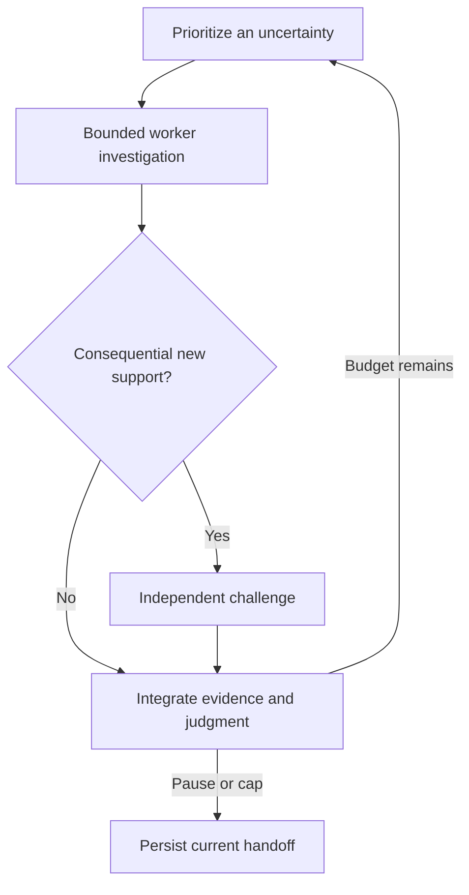

# Systematic corpus loop

This is the canonical research-loop policy. Investigate the owner-scoped question and its connection to the [root goal](https://github.com/moritzbrantner/truth-core/issues/143), without presuming a preferred answer. Build a graph of meaningful arguments, implications, incompatibilities and open dependencies, and issue reasoned **overall provisional judgments** as the evidence develops. `AGENTS.md` governs repository operations, source fidelity and formal verification; the configuration and source workflows below are methods selected within this loop.

## Bounded investigations and integration

The coordinator maintains the priority queue and one current handoff. It gives each fresh worker a target, relevant existing evidence, a live uncertainty, a work budget, and the expected useful change. Record the run's total budget and each worker's cap before starting; choose and state a bounded default if the owner has not supplied one. A continuous investigation consists of these bounded turns, not an indefinitely expanding worker conversation.



1. **Retrieve and fix the question.** Inspect `context <ARGUMENT-OR-RESULT-ID>`, `related <STMT-ID>` and the relevant `dossier <STMT-ID>`. Reuse definitions, senses, exact theorems, sources and failed attempts. State the chosen reading, logical background, domain and model class. Preserve consequential alternatives; a complete map of every interpretation is not a prerequisite.
2. **Investigate flexibly.** Pursue the most informative support, rival, implication, necessary precondition, incompatibility, source or connection. Formalize load-bearing deductions and test revealing models where useful. A rival should be represented by its strongest relevant commitments; a local objection need not first supply an entire worldview. Explore conditional consequences without first proving every primitive.
3. **Decompose only where useful.** Follow disputed premises and load-bearing terms as deeply as the current question requires. Split records for consequential inference, independent warrant, rival discrimination or reuse. Identify honest primitives and open bridges; neither a new predicate name nor a definition settles its applicability. Reuse shared [definition dependencies](corpus-model.md#definition-dependencies-and-formal-meaning). Do not expand ordinary vocabulary just for coverage.
4. **Return a bounded result.** Return early after a useful finding, or at the cap, blocker or loss of expected value. State what uncertainty changed, exact evidence and assumptions, surviving objections, the proposed provisional assessment, and the next discriminating step. An honest “no useful result” is permitted; record the attempted approach and what would justify retrying it. Finishing a worker turn does not settle its proposition.
5. **Integrate and requeue.** The coordinator checks the contract below, connects findings to the parent question, revises the overall judgment and priorities, and assigns the next fresh worker. Requeue unfinished work with a specific next step or reopening condition, not an instruction to repeat the same unsuccessful search. Pause when the run budget ends or no authorized useful next step remains.

Keep the readable case, judgments and rivals in the existing issue or linked case note; keep proofs, sources, countermodels and substantive attempts in their canonical records/dossiers. The current handoff links them. This policy adds no tracker, schema, truth-status field or numerical confidence score. Attempt outcomes describe work, not truth; their `evidence` field retains its existing result/claim/PR reference rules ([attempt format](premise-dossiers.md)).

## Provisional judgments and premise warrant

The master must state the current **overall epistemic assessment**, not merely list conditional results: for example, an interpretation is currently favored, a claim is provisionally supported, or the evidence remains underdetermined. Assess cumulative support across routes while exposing their shared dependencies. Do not manufacture a preference when the evidence does not discriminate. If a turn adds no relevant evidence, retain the prior assessment and say that it is unchanged.

Each judgment records:

- the exact claim, reading, scope, date and evidence revision;
- the assessment, the reasons for it, and the criteria or inference rule used;
- supporting and adverse evidence, shared sources/bridges, and open assumptions;
- the strongest objections, unexamined alternatives and review disagreements;
- what would strengthen, weaken, reverse or suspend the assessment.

These judgments may guide scheduling, support qualified reports and be used as **explicit provisional premises** in further reasoning. Every downstream use must retain their dependencies and provisional character. They never by themselves create a Lean proof, mark a rival refuted, change computed frontier establishment or authorize floor closure. Personal assent and unexplained labels such as “unreasonable” supply no warrant. Existing approval-based floor metadata is [legacy runtime behavior](corpus-model.md#premise-program-and-frontier), not an epistemic shortcut; do not create new `owner_approval` markings from this loop.

Admit the following as possible grounds, then assess whether they actually support this claim. Record the inference and credible defeaters rather than treating a category label as evidence:

| Proposed ground | Required assessment and possible defeaters |
|---|---|
| Observation or actual performance | Identify what occurred and how it was identified; distinguish the observation from its interpretation. Misidentification, unreliable access or an unjustified generalization can defeat the support. |
| Testimony or source material | Establish what the source says separately from why it is credible about the matter. Trace dependence, contrary evidence and attribution uncertainty; repeated quotations from one source are not independent witnesses. |
| Conceptual argument or necessary precondition | Reconstruct the inference under the exact meanings. Challenge counterexamples, circularity, disputed bridges and substantive assumptions concealed in definitions. |
| Explanatory comparison | State evidence, candidates, criteria, disputed judgments and why the criteria are truth-relevant. Test sensitivity to alternatives and allow ties or incomparability. Being best among examined candidates does not exclude unexamined ones. |

Warrant standards and their application remain challengeable research targets. They need not all be settled before conditional exploration proceeds. Non-deductive support remains defeasible: identify the rule that licenses using it and the conditions for withdrawing that use. A scheduling reason such as tractability is not evidence that a proposition is true.

For the meaning example, distinguish **if an actual denial is meaningful, some language has meaning** from the grounds for judging that a particular performance was meaningful. A meaningless utterance supplies no articulated denial; this does not establish that all utterances are meaningful or settle broader semantic theories. Record the actual-performance premise and its challenges separately from the conditional proof.

## Integration and revision contract

Keep these assessments separate in existing records and reports; do not collapse them into one “established” label:

| Assessment | What it licenses |
|---|---|
| Formal verification | The exact encoded consequence under its hypotheses and permitted logical background. |
| Semantic fidelity | A reviewed correspondence between the intended claim and its encoding, with unresolved disagreements visible. |
| Premise warrant | A reasoned, revisable assessment of the grounds for accepting the premise. |
| Outstanding objections | The exact challenge, its target and what has or has not answered it. |
| Work status | Whether an investigation succeeded, failed, is paused or should be reopened; no truth conclusion follows from this alone. |

Before a consequential definition, bridge, claimed defeat or influential judgment change is relied on as reviewed support, obtain a separate worker's challenge review. Reconstruct the claim in plain language; inspect revealing examples/counterexamples, quantifiers, modality, hidden assumptions and the strongest relevant objection. Check claimed novelty against prior work. Retain disagreements rather than treating reviewer agreement as proof. Routine derivations reuse the existing checks and unchanged review evidence. Conditional exploration may continue while review is pending, with that limitation explicit.

Integration must also enforce these boundaries:

- **Context compatibility.** Compose only matching meanings, domains, logic and model classes, or record an explicit justified bridge. Similar words or theorem shapes do not supply that bridge.
- **Joint support.** Preserve complete jointly required premise bundles and alternative routes. An incompatibility of `{A, B, C}` does not show pairwise incompatibility or select which member to reject. Coverage and exclusivity are separate obligations, needed only for inferences that use them.
- **Nonvacuity.** Record whether the relevant bundle has a joint model, a demonstrated contradiction, or unresolved satisfiability, always relative to its background. Seek witnesses where practical; do not require a model for every investigation. A deduction from a known inconsistent bundle remains a formal consequence, but supplies no affirmative support for its conclusion. Preserve the incompatibility and reassess affected support routes.
- **Dependency independence.** `A → B` and `B → A` supply no independent warrant for either. Audit shared sources, unsupported bridges and cycles before claiming corroboration. Another argument can add structural insight without adding independent evidence.
- **Revision.** When a definition, premise warrant or judgment changes, identify affected downstream uses and flag their interpretations or qualified conclusions for reassessment. Preserve valid theorems about the earlier meaning. Withdraw only the defeated support route; assess surviving routes separately. Keep the reason and evidence for each judgment revision.

Apply three checks to any change in this policy: a correct proof of a mistranslated claim keeps its formal result but loses the claimed interpretation; an inconsistent assumption bundle yields an incompatibility rather than an affirmative victory; two arguments sharing an unsupported bridge leave that common dependence visible. A reversal of a provisional judgment must propagate through its qualified uses without pretending that a theorem's encoded statement changed.

## Priority and cumulative progress

Select work by the importance of the live question, the expected value of discriminating evidence, shared dependency impact, current support and objections, tractability and time already deferred. A low-confidence consequential bridge can deserve higher priority than another proof of a favored position. `frontier`, `thickness`, `orphans`, dossiers and source candidates inform the queue; none alone determines it.

Default to reserving at least one of every five worker starts for a neglected plausible interpretation or a challenge to influential support. Record a reason when no such target is available, and raise the priority of repeatedly deferred relevant work. The coordinator may adjust this allocation to the run budget with an explicit rationale in the existing handoff; do not silently remove exploration capacity.

After ten completed turns, at the run cap, or after a consequential revision, give a brief synthesis of the central question: what is now favored and why, which combinations were excluded, which bridges gained or lost support, and which shared dependencies remain decisive. Adjust the interval for short runs. Count clearer distinctions, informative conditional results, weakened assumptions, exposed dependencies and precise exhausted approaches as progress; do not substitute node counts, route cost or a guaranteed discovery per worker. Convergence means improving the assessment and locating remaining disagreement; it does not promise a final foundation or a monotonic increase in certainty.

The [configuration elimination method](configuration-elimination-loop.md#certified-forks-for-selected-investigations) and [#565 pilot note](notes/argument-first-pilots-565.md) supply particular proof tactics, not mandatory preliminary stages for every turn.

### Machine-checkable issue acceptance (#949)

An issue can declare its completion evidence in **one** fenced block in its body
or one designated comment. This is an optional reconciliation aid, not another
corpus registry or a permission to close issues automatically:

````markdown
```truth-core-acceptance
results: [RESULT-ID]
theorems: [TruthCore.Namespace.theorem]
statements: [STMT-ID: closed, STMT-OTHER: sourced]
configurations: [CONFIG-ID]
attempts: [ATTEMPT-ID]
```
````

Each field is optional; at least one nonempty bracketed list is required. IDs
are comma-separated and unquoted. `results` requires an existing
`solution-present` result record. `theorems` requires a registered result's
theorem and its corresponding source declaration in the checked-out revision.
For statements, `closed` accepts any computed frontier closure, `proved`
requires the non-transcription `proved` closure, and `sourced` requires an
attributed source claim with a locator. Configuration and attempt IDs require
records to exist; a failed attempt is **not** evidence of derivability.

```bash
python3 scripts/corpus.py issues                        # read-only gh issue list
gh issue list --state open --limit 1000 --json number,title,body,url,comments > /tmp/truth-core-issues.json
python3 scripts/corpus.py issues --from /tmp/truth-core-issues.json --json
python3 scripts/corpus.py issues --from /tmp/truth-core-issues.json --for STMT-ID
python3 scripts/corpus.py dossier STMT-ID --issues-from /tmp/truth-core-issues.json
```

The report distinguishes `delivered`, `missing`, `malformed` and `untracked`;
its JSON includes a reverse index from canonical IDs to issue numbers. It is a
read-only projection of the checked-out corpus and optional issue snapshot,
not a live Lean/Comparator/source verification or proof of philosophical truth.
Run it on `main` to reconcile the current main branch; a feature checkout
reports that checkout's hypothetical state. Human/coordinator review decides
whether an issue can actually close.

## Semantic grounding of metaphysical relations

For newly introduced or substantially reinterpreted relations involving causation,
dependence, grounding, contingency, necessity or explanation, follow the semantic
grounding requirement in `AGENTS.md`. Before philosophically significant relations
support a metaphysical conclusion, answer these questions in their existing
definition/disambiguation records or linked research notes, with evidence and
explicit **OPEN** burdens where answers remain
undefended:

1. **Meaning.** What does the relation mean in ordinary language, without relying
   on its symbol or formal properties to explain it?
2. **Phenomena.** What are its clearest concrete examples and counterexamples,
   and why do they instantiate or fail to instantiate this meaning? Explicitly
   record why examples remain unavailable when that is the case.
3. **Exclusions.** Which nearby cases fail to instantiate it, and what excludes
   them? Distinguish efficient causation, grounding and conservation rather than
   treating their names as interchangeable.
4. **Properties.** What independently justifies each property the argument uses,
   especially asymmetry, transitivity and well-foundedness, for this interpreted
   relation on the stated domain? A physical example or the word “essential” is
   not a proof of well-foundedness. A finite or inductively generated model proves
   properties of that construction; it does not silently discharge well-foundedness
   of actual dependence. State whether a property concerns one local relation or
   a union of relations: properties of each component need not hold for the union.
5. **Abstraction.** Why does an interpretation illustrated by physical causation,
   electricity, motion or support license the proposed claim about existence or
   general metaphysical dependence? Identify and defend the bridge, its domain
   and limits; shared vocabulary or relational form does not supply it.
6. **Rivals.** How does the interpretation fare against serious competing accounts
   of the same phenomena and explanatory task? Preserve their strongest objections
   and any unresolved disagreement.

Prioritize the independent property justifications and the abstraction bridge
(questions 4–5). A pure relational theorem establishes a conditional mathematical
consequence, not the causal applicability of its relation. Such theorems remain
useful and may be developed with open interpretive burdens. Any philosophical
support remains explicitly conditional or provisional to the extent those
burdens are unresolved; the theorem does not settle its own applicability. Preserve
the exact assumptions and unmet burdens in the existing records; this requirement
adds no registry or verification gate and changes no source-fidelity standard.
Independent justification may be a defensible philosophical argument, with its
assumptions and defeaters explicit; it need not be empirical evidence or a kernel
proof of every premise. Source attribution and formal consequence remain distinct
from that independent defense.

## Progress is depth on the root path, not volume

Use `python3 scripts/corpus.py frontier --routes` and `--reaching-root`. Report exactly what changed for root-facing open premises, including **no change** for unconnected outposts.

- An open premise is **bare** (no source claim states or supports it), **supported** (only a `supports` relation backs it, its note recording the gap, or only a bibliographic citation without pinned bytes or a permanently unavailable witness states it) or **stated** (a claim on a pinned source states it); supported and stated premises are undefended (#987). These are source/closure descriptions, not an ordering of philosophical credibility or research priority.
- A transcription (`opaque_atoms`, `single_application`, `assembly`, `instantiation`) does not close an open conclusion; it propagates closure only when **all** its premises are closed. An alleged refutation counts only when verified **and** all its premises are closed.
- Replacing one open premise with narrower leaves ("relocation") is legitimate exploration even when it adds bare premises; `frontier-diff` lists them for visibility and `thickness` reports the derivations gained (owner decision 2026-11-07, superseding the no-bare rule of #987). Report supported leaves as supported, not as stated.
- **Account for connections.** Inspect disconnected verified families (`truth orphans`) as possible bridge targets. Every new family needs a root-route purpose or a specific connection plan and blocker. Report unconnected work honestly; connection alone does not discharge a premise. Use the priority policy above rather than automatically favoring idle work or a complete sense fork.
- Neither source attribution, a conditional theorem, a narrative, nor an unverified model proves a premise. Preserve exact semantics, assumptions, and surviving rivals; see [configuration elimination](configuration-elimination-loop.md).

## 1. Campaign: a meaningful source objective

A coarse GitHub issue names a coherent source objective and completion criteria; it is not a second status tracker. Choose source reading when a live argument needs that evidence, not just to grow coverage.

## 2. Candidate: the next contiguous source range

`corpus/candidates/*.json` queues chapter-sized or similarly coherent ranges. Use `python3 scripts/corpus.py next` when doing source ingestion:

1. Materialize the verified witness; read the whole range and context before splitting it.
2. Proceed in source order. Record substantive readings and inferential steps, reuse existing identities, and preserve defensible alternatives. Skip filler; not one claim per sentence.
3. Apply the atomic research/proof contract in `AGENTS.md`. Keep the same candidate and advance its locator after a partial batch; delete it only when its range is exhausted.

## PR boundary

Ship one coherent verified argument cluster, a complete candidate range, or a reviewable part of it (about 5–10 claims at most, not a quota). Report premise effects and remaining gaps; persist substantive failed attempts before handoff. A PR boundary does not end the investigation.

## Parallel lanes

Follow the A/B/C ownership in `AGENTS.md` (#416). Shared Lean imports and documentation tables are generated, never hand-edited; rerun `scripts/root-imports.sh --write` and `python3 scripts/docs_index.py --write` after merging `origin/main` before pushing.

## Completion and coverage

A source range is complete once read and its relevant substantive content represented or explicitly judged out of scope; it need not generate a claim for every sentence. A bounded frontier slice may end with a useful finding, a precise blocker, changed priority, exhausted approach or budget cap. Record what remains and what would justify continuation. Settling the proposition is a separate matter; a conditional result with open premises is not established.

## Failed proofs feed research

Record the missing inference, attempted approach and any countermodel actually found; an unsuccessful search supplies no countermodel by itself. Consider whether the failure exposes an incompatible bundle, useful distinction or warrant question. Pursue the next discriminating step when justified, without inventing an axiom, stronger source reading or automatic queue entry for every primitive.

## Campaign handoff

When a source campaign finishes, record its known successor and seed its first source-range candidate before closure. Keep one current handoff. The master selects further work within the run budget; a successor candidate does not outrank the research queue automatically. Ask the owner only for a concrete unresolved action or scope decision needed now, not to settle a philosophical disagreement.

## Campaign ordering

Prioritize the active frontier slice and its blockers; source campaigns follow those needs. Within a campaign, finish the current range, backfill necessary foundations, then continue the source while useful. The original Aristotle `Physics` III → I–II → IV–VIII order remains a fallback, not a competing global priority.
