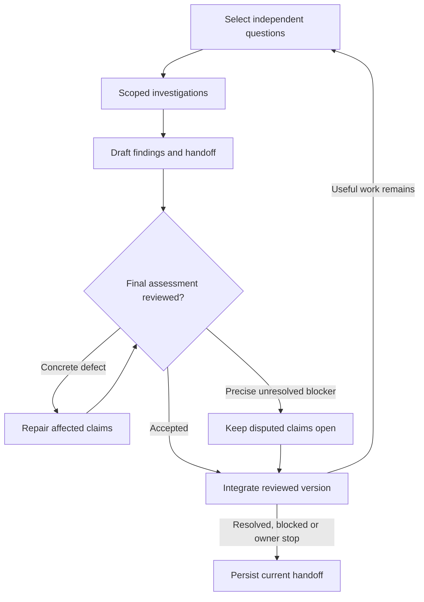

# Systematic corpus loop

This is the canonical research-loop policy. Investigate the owner-scoped question and its connection to the [root goal](https://github.com/moritzbrantner/truth-core/issues/143), without presuming a preferred answer. Build a graph of meaningful arguments, implications, incompatibilities and open dependencies, and issue reasoned **overall provisional judgments** as the evidence develops. `AGENTS.md` governs repository operations, source fidelity and formal verification; the configuration and source workflows below are methods selected within this loop.

## Bounded investigations and integration

The coordinator maintains priorities and one current handoff. Give fresh workers a target, existing evidence, live uncertainty, explicit ownership and expected useful change. Apply [Research continuation and stopping](../AGENTS.md#research-continuation-and-stopping-owner-direction-2026-11-10): no default token, time, depth, batch or PR budget. Continue concrete relevant work; workers report resolved or stalled branches for master reassessment. Independent investigations run concurrently under the [parallel-lane policy](#parallel-lanes). Explicit owner limits and runtime constraints still apply.



1. **Retrieve and fix the question.** Inspect `context <ARGUMENT-OR-RESULT-ID>`, `related <STMT-ID>` and the relevant `dossier <STMT-ID>`. Reuse definitions, senses, exact theorems, sources and failed attempts. State the chosen reading, logical background, domain and model class. Preserve consequential alternatives; a complete map of every interpretation is not a prerequisite. If a proposed generalization already follows by instantiating or composing an existing theorem, return that dependency or a short reuse lemma rather than a duplicate campaign.
2. **Investigate flexibly.** Pursue the most informative support, rival, implication, necessary precondition, incompatibility, source or connection. Formalize load-bearing deductions and test revealing models where useful. A rival should be represented by its strongest relevant commitments; a local objection need not first supply an entire worldview. Explore conditional consequences without first proving every primitive.
3. **Decompose only where useful.** Follow disputed premises and load-bearing terms as deeply as the current question requires. Split records for consequential inference, substantive warrant, rival discrimination or reuse. Identify honest primitives and open bridges; neither a new predicate name nor a definition settles its applicability. Reuse shared [definition dependencies](corpus-model.md#definition-dependencies-and-formal-meaning). Do not expand ordinary vocabulary just for a larger count; useful coverage of distinct questions and rival views is welcome.
4. **Report substantive reassessment points.** Report when the question is resolved, unavailable evidence/capabilities or an owner decision blocks progress, repeated approaches expose the same obstacle without a materially different next test, or a more consequential question warrants a scope change. Persist changed uncertainty, exact evidence and assumptions, standing rivals and their prices, failed approaches, provisional assessment and next tests. A useful result, open premise or surviving countermodel alone is not a stopping condition: descend into relevant subarguments and reconnect findings to the parent. Continue other available work within the assignment. Failed search does not exhaust a question.
5. **Draft, challenge and repair.** The coordinator prepares the complete proposed outcome: record/graph changes, overall judgments, diagrams and handoff. Apply the [final outcome review](#final-outcome-review-and-repair) before relying on new consequential assertions as reviewed support. A review of worker outputs does not cover a stronger coordinator summary.
6. **Integrate and requeue.** Integrate the reviewed version, connect findings to their parent questions, update priorities and assign the next fresh worker. Requeue unfinished work with a specific next step or reopening condition, not an instruction to repeat the same unsuccessful search. Continue across PR checkpoints. Stop only when the requested scope is substantively resolved, every remaining branch has a concrete blocker preventing useful work, or the owner stops the loop. Preserve resumable handoffs for runtime interruptions.

Keep the readable case, judgments and rivals in the existing issue or linked case note; keep proofs, sources, countermodels and substantive attempts in their canonical records/dossiers. The current handoff links them. This policy adds no tracker, schema, truth-status field or numerical confidence score. Attempt outcomes describe work, not truth; their `evidence` field retains its existing result/claim/PR reference rules ([attempt format](premise-dossiers.md)).

## Provisional judgments and premise warrant

The master must state the current **overall epistemic assessment**, not merely list conditional results: for example, an interpretation is currently favored, a claim is provisionally supported, or the evidence remains underdetermined. Assess cumulative support across routes while exposing their shared dependencies. Do not manufacture a preference when the evidence does not discriminate. If a turn adds no relevant evidence, retain the prior assessment and say that it is unchanged.

Each judgment records:

- the exact claim, reading, scope, date and evidence revision;
- the assessment, the reasons for it, and the criteria or inference rule used;
- supporting and adverse evidence, shared sources/bridges, and open assumptions;
- the strongest objections, unexamined alternatives and review disagreements;
- what would strengthen, weaken, reverse or suspend the assessment.

These judgments may guide scheduling, support qualified reports and be used as **explicit provisional premises** in further reasoning. Every downstream use must retain their dependencies and provisional character. They never by themselves create a Lean proof, mark a rival refuted, change computed frontier establishment or authorize floor closure. Personal assent and unexplained labels such as “unreasonable” supply no warrant. Existing approval-based floor metadata is [legacy runtime behavior](corpus-model.md#premise-program-and-frontier), not an epistemic shortcut; do not create new `owner_approval` markings from this loop.

Admit the following as possible grounds, then assess whether they actually support this claim. Record the inference and credible defeaters rather than treating a category label as evidence:

| Proposed ground | Required assessment and possible defeaters |
|---|---|
| Observation or actual performance | Identify what occurred and how it was identified; distinguish the observation from its interpretation. Misidentification, unreliable access or an unjustified generalization can defeat the support. |
| Testimony or source material | Establish what the source says separately from why it is credible about the matter. Trace dependence, contrary evidence and attribution uncertainty; repeated quotations from one source are not independent witnesses. |
| Conceptual argument or necessary precondition | Reconstruct the inference under the exact meanings. Challenge counterexamples, circularity, disputed bridges and substantive assumptions concealed in definitions. |
| Explanatory comparison | State evidence, candidates, criteria, disputed judgments and why the criteria are truth-relevant. Test sensitivity to alternatives and allow ties or incomparability. Being best among examined candidates does not exclude unexamined ones. |

Warrant standards and their application remain challengeable research targets. They need not all be settled before conditional exploration proceeds. Non-deductive support remains defeasible: identify the rule that licenses using it and the conditions for withdrawing that use. A scheduling reason such as tractability is not evidence that a proposition is true.

For the meaning example, distinguish **if an actual denial is meaningful, some language has meaning** from the grounds for judging that a particular performance was meaningful. A meaningless utterance supplies no articulated denial; this does not establish that all utterances are meaningful or settle broader semantic theories. Record the actual-performance premise and its challenges separately from the conditional proof.

### Cumulative warrant and support options

For a proposition `P`, retain distinct but compatible ways to assess it:

- **Direct or prima facie acceptance:** one may find `P` credible on its own terms, through experience, a basic intellectual seeming, a constitutive commitment or a necessary condition of actual reasoning. This is revisable epistemic warrant, not automatically a `self_evident` floor marking or formal establishment.
- **Argumentative support:** one may accept `P` because `A` and `B` imply it under an explicitly interpreted, verified argument. `A` and `B` may themselves have direct warrant or further derivations. Preserve `P` as a direct option alongside this bundle; do not count the expansion as a regression.
- **Holistic and comparative support:** connected propositions can reinforce an interpretation through coherence, explanatory integration, successful applications, and the costs or failures of competing accounts. Shared premises and mutually supporting arguments are normal; record them so the same evidence is not falsely counted twice.

There is **no universal requirement for an independent proof of each premise** or for every support route to have disjoint foundations. Nor must every primitive be recursively derived before a provisional assessment is possible. Inspect instead what each line of support contributes, what observations or practices connect the web to its subject matter, whether it merely assumes the conclusion, and what substantive defeaters survive. Bare `A → B` and `B → A` alone do not justify either proposition, but that does not disqualify an otherwise warranted network. A proposition may reasonably remain a primitive of the inquiry, with its meaning and revision conditions explicit.

Record self-refutation, self-undermining, absence of a view-internal reason to adopt it, and incompatibility with prerequisites of the activity separately. A view that fails one of these *substantive* tests loses comparative credibility under the tested scope; survival of relevant testing may raise relative confidence. Neither mere logical consistency nor the absence of an invented objection proves a view true, and eliminating one rival does not prove an unexhausted alternative. Such evaluations belong in the overall provisional judgment rather than automatically changing formal closure or a truth score.

## Integration and revision contract

Keep these assessments separate in existing records and reports; do not collapse them into one “established” label:

| Assessment | What it licenses |
|---|---|
| Formal verification | The exact encoded consequence under its hypotheses and permitted logical background. |
| Semantic fidelity | A reviewed correspondence between the intended claim and its encoding, with unresolved disagreements visible. |
| Premise warrant | A reasoned, revisable assessment of the grounds for accepting the premise. |
| Outstanding objections | The exact challenge, its target and what has or has not answered it. |
| Work status | Whether an investigation succeeded, failed, is paused or should be reopened; no truth conclusion follows from this alone. |

### Final outcome review and repair

The coordinator owns a bounded correction loop. Use the existing PR, case note and current handoff; this is a publication procedure, not another tracker or proof-status registry. Review each returned cluster as it becomes ready while other investigations continue. A complete proposed outcome means the cluster being integrated; it does not require a whole-run barrier. At the run's close, review only new synthesis claims and reuse unchanged reviews.

1. **Prepare the actual draft.** Give the challenger the proposed record/graph changes and the complete judgment, diagram and handoff text, with the evidence revision. Identify each consequential assertion by its existing record or a heading in the draft. Keep its assumptions, interpretation/scope, exact theorem/model/source locator, verification status and limitations together, either in the linked record or a compact draft table. An open interpretation bridge must remain visible in the summary. Run the existing reference and binding checks for changed records; a valid identifier does not establish that the cited definition or source is relevant.
2. **Challenge the draft against the evidence.** A fresh reviewer reads the actual definitions, statements, proofs, model assignments and source passages needed for the claim, rather than accepting the author's or an earlier reviewer's verdict. Apply the [semantic checks](#independent-semantic-challenge) below. In particular, try existing countermodels against universal and only-if summaries; compare the original and strengthened assumption bundles; open definition links; and inspect the reasons for philosophical rankings or rival dismissals. A new deductive extension must have its own checked result to inherit formal-verification status. An unverified inference may remain explicitly provisional, with its reasoning reviewed and its dependencies retained.
3. **Require substantiated findings.** Each objection identifies the exact draft assertion, evidence, concrete mismatch or missing inference, and the smallest necessary repair. Distinguish a demonstrated error from an unresolved philosophical objection; neither an unsupported criticism nor model agreement settles the question. A no-findings return is valid. Preserve the review's scope and evidence revision in the existing PR or handoff so a later wording change cannot silently inherit that review.
4. **Repair within the cap.** The originating researcher repairs its code and corpus records; the coordinator repairs its synthesis, and the challenger checks the affected assertions. Follow the [ownership contract](#worker-ownership-and-integration) for any transfer. Default to at most two targeted review-and-repair passes after the initial challenge, while preserving the research continuation rule. Recheck only changed consequential assertions and affected dependencies; reuse unchanged evidence and reviews. At the cap, retain the accepted findings, withdraw or qualify the unsupported conclusions, record the disputed questions and affected uses as unresolved, and continue independent investigations. Routine repairs and philosophical disagreement do not require an owner decision. Escalate only an actual authorization, scope or budget choice needed to proceed.
5. **Publish the reviewed substance.** Use the reviewed wording and qualifications in the records, diagram and handoff. Do not add a stronger arrow, verdict or generalization while shortening the final report. A substantive change reopens review of that claim and its affected uses; formatting alone does not. An unresolved disposition reports the disagreement and withheld conclusion, rather than introducing a fresh resolution after the repair cap. A completed review accepts only the stated scope and status; it does not establish a premise or waive CI and merge requirements.

Routine derivations with unchanged meanings reuse the existing checks and review evidence. The final check is on the changed consequential assertions and their synthesis, not a new full-repository review each cycle. Conditional exploration may continue while review is pending, with that limitation explicit.

### Independent semantic challenge

Before a consequential definition, bridge, claimed defeat or influential judgment change is relied on as reviewed support, obtain a separate worker's challenge review under the procedure above. Apply these checks to the **final consequential findings**, including claims introduced or changed during synthesis:

1. **Map the intended claim.** Restate it plainly and map each load-bearing narrative commitment to an encoded condition, definition or hypothesis, or an explicit **OPEN** interpretation bridge. Inspect quantifiers, modality, hidden assumptions and the strongest relevant objection. Names and suggestive prose do not supply missing conditions.
2. **Inspect the actual witness.** Check whether the model preserves the entities and relations required by the motivating claim, including their existence and identity across the relevant situations. For example, an empty comparison world may witness an abstract modal non-entailment while failing a reading that requires an object, its material or its origin there. When the encoding omits commitments needed by that interpretation, label the result a **structural surrogate** and state exactly what it witnesses.
3. **Restore omitted commitments.** Test whether adding the intended but omitted conditions preserves the countermodel or consequence. It may destroy the countermodel. If this test remains open, keep the stronger interpretation unresolved; do not carry the surrogate's result across that gap.
4. **Compare readings and warrant.** Preserve meaningful alternatives and compare their consequences under explicit assumptions without forcing a winner. Logical weakening can improve a sufficient premise set; it does not by itself establish equal or greater warrant or applicability. Check claimed novelty against the exact prior theorems and dependencies.

Retain disagreements rather than treating reviewer agreement as proof. A stronger assumption bundle becoming inconsistent does not invalidate a model of the original bundle. A local or reachable-world result does not establish its global counterpart, and a bounded unsuccessful rival search does not exclude unexamined rivals.

### Revision boundaries

Integration must also enforce these boundaries:

- **Context compatibility.** Compose only matching meanings, domains, logic and model classes, or record an explicit justified bridge. Similar words or theorem shapes do not supply that bridge.
- **Joint support.** Preserve complete jointly required premise bundles and alternative routes. An incompatibility of `{A, B, C}` does not show pairwise incompatibility or select which member to reject. Coverage and exclusivity are separate obligations, needed only for inferences that use them.
- **Nonvacuity.** Record whether the relevant bundle has a joint model, a demonstrated contradiction, or unresolved satisfiability, always relative to its background. Seek witnesses where practical; do not require a model for every investigation. A deduction from a known inconsistent bundle remains a formal consequence, but supplies no affirmative support for its conclusion. Preserve the incompatibility and reassess affected support routes.
- **Dependency audit, not independence quota.** `A → B` and `B → A` by themselves supply no new warrant for either. Audit shared sources, unsupported bridges and cycles before claiming *independent corroboration*, but consider the cumulative web and any prima facie or practice-based grounds it contains. An argument can improve understanding or support options without an entirely separate evidential ancestry.
- **Revision.** When a definition, premise warrant or judgment changes, identify affected downstream uses and flag their interpretations or qualified conclusions for reassessment. Preserve valid theorems about the earlier meaning. Withdraw only the defeated support route; assess surviving routes separately. Keep the reason and evidence for each judgment revision.

Apply three checks to any change in this policy: a correct proof of a mistranslated claim keeps its formal result but loses the claimed interpretation; an inconsistent assumption bundle yields an incompatibility rather than an affirmative victory; two arguments sharing an unsupported bridge leave that common dependence visible. A reversal of a provisional judgment must propagate through its qualified uses without pretending that a theorem's encoded statement changed.

## Priority and cumulative progress

Select work by the importance of the live question, the expected value of discriminating evidence, shared dependency impact, current support and objections, tractability and time already deferred. A low-confidence consequential bridge can deserve higher priority than another proof of a favored position. `frontier`, `thickness`, `orphans`, dossiers and source candidates inform the queue; none alone determines it.

Default to reserving at least one of every five worker starts for a neglected plausible interpretation or a challenge to influential support. Record a reason when no such target is available, and raise the priority of repeatedly deferred relevant work. The coordinator may adjust this allocation to current research needs with an explicit rationale in the existing handoff; do not silently remove exploration capacity.

After ten completed turns, at a substantive stopping point, or after a consequential revision, give a brief synthesis of the central question: what is now favored and why, which combinations were excluded, which bridges gained or lost support, and which shared dependencies remain decisive. Adjust the interval for short runs. Count broader meaningful coverage, alternative conditional support bundles, clearer distinctions, informative results, weakened assumptions, exposed dependencies and precise exhausted approaches as progress, including when open-premise or root-closure totals do not change. Node and argument counts describe scale; route cost describes expanded obligations. None is a quality score, quota or recurring complaint. Assess throughput by accepted meaningful findings per elapsed run, with their time/resource costs and dominant review, build or CI waits recorded in existing logs or the current handoff. Claim and PR counts are not substitutes for this evidence. Convergence means improving the assessment and locating remaining disagreement; it does not promise a final foundation or a monotonic increase in certainty.

The [configuration elimination method](configuration-elimination-loop.md#certified-forks-for-selected-investigations) and [#565 pilot note](notes/argument-first-pilots-565.md) supply particular proof tactics, not mandatory preliminary stages for every turn.

### Model selection and unattended batches

Treat model selection as a role-specific experiment for research, synthesis and challenge review. A different model family may be tried for the challenger when available; do not assume that diversity or agreement establishes correctness. The [review calibration cases](notes/research-review-calibration.md) provide known failure patterns and valid controls. Compare models with the same evidence and budgets, using fresh briefs without the answer key or earlier verdicts; use unexposed variants once a case has become a teaching example. Record substantiated errors missed, false objections, successful repairs, time and available cost measurements in the existing handoff. Do not infer research ability from review scores alone.

Calibration and sampled audits are periodic work, not a requirement to benchmark models or repeat every review each cycle. For a bounded unattended batch, reserve independent audit capacity and record consequential errors that escaped review, human interventions and useful findings per elapsed time. Correct escaped errors and affected uses through the same repair procedure. Continue unattended research under the continuation rule and within the authorized scope; absence of a finding is not proof that no error remains. The owner receives periodic research syntheses and necessary decisions, while routine review and repair stay inside the loop.

### GitHub research issue contract

A research issue is a **scoped question for the work loop**, not a predetermined
conclusion, exhaustive proof plan, duplicate corpus record or permanent activity
log. Keep the current actionable brief easy to find. Author or reconcile it
using these seven parts; link to canonical records for details rather than
copying them into the issue:

1. **Question and scope.** State the discriminating question, explanandum,
   interpretation, domain and relevant logical background. Distinguish it
   from adjacent questions; do not assume the desired answer.
2. **Graph destination.** Name the existing statement/argument/root-route
   target, or the *proposed* bridge to it and the substantive blocker. Mark
   unbuilt connections **OPEN**. A useful rival analysis can connect through
   a named incompatibility, prerequisite or explanatory comparison; do not
   invent a verified edge just to make it look connected.
3. **Reuse and current baseline.** Point to known statement, argument,
   definition/sense, result, attempt, dossier and prior issue/PR IDs as
   applicable. Search for reusable arguments and countermodels before adding
   records. Refresh these pointers and the `main` revision at **dispatch**;
   an issue written yesterday is not a frozen authority over today's corpus.
4. **Rivals and decisive tests.** Represent the strongest relevant positive
   alternatives explaining the **same** thing, with their actual commitments.
   Say which differences or observations would favor one, weaken another or
   expose an incompatibility. For a proposed symmetry-breaker, compare
   like-for-like scope, background and explanatory criteria; do not assign
   equal priors or declare defeat by stipulation. Objections must identify a
   substantive premise, mechanism, counterexample or inference gap—not a
   merely imaginable escape.
5. **Research paths, not a mandated result.** Offer promising routes:
   premise weakening, implications, competing interpretations, concrete
   countermodels, warrants, positive rival mechanisms and type-correct
   bridges. Let findings redirect the investigation. Preserve direct and
   derived support options and consequential alternative senses; require
   neither a fixed depth nor a complete argument tree upfront.
6. **Expected useful outcome and checks.** Specify what would make one
   coherent contribution: a verified conditional inference, meaningful new
   support route, refined bridge, concrete model boundary, warranted rival
   comparison, or a precise blocker with a next test. Identify relevant
   Lean/Comparator/NanoDa, corpus, binding and semantic-review checks where
   applicable. Conditional results retain their open premises; valid Lean
   does not by itself establish fidelity, warrant or the intended graph edge.
   Neither a proof nor an immediate improvement in root-frontier metrics is
   compulsory.
7. **Completion and next step.** After review, record exactly what landed
   (records, theorem/model, PR and computed `truth frontier-diff` where
   applicable), what remains **OPEN**, and the next distinct test or
   reopening condition. Separate delivered work from philosophical
   resolution. Close an issue only when **its stated scope** is delivered;
   requeue genuine remaining research through the current handoff or a
   distinct, linked issue, never a duplicate activity tracker.

**Dispatch and reconciliation.** The coordinator selects one live uncertainty
and its file/graph ownership from the issue for a worker brief, allowing the
worker to follow substantive dependencies without a fixed work cap. On
completion, reconcile the accepted findings against current `main`, update
the existing issue's visible current status and links, and leave historical
details in comments or canonical records. Do not treat issue closure, a PR,
or an optional acceptance block as evidence that a premise is true. Apply
[final outcome review](#final-outcome-review-and-repair), [revision boundaries](#revision-boundaries)
and [worker handoff](../AGENTS.md#worker-brief-and-handoff)
before relying on consequential new connections.

### Machine-checkable issue acceptance (#949)

An issue can declare its completion evidence in **one** fenced block in its body
or one designated comment. This is an optional reconciliation aid, not another
corpus registry or a permission to close issues automatically:

````markdown
```truth-core-acceptance
results: [RESULT-ID]
theorems: [TruthCore.Namespace.theorem]
statements: [STMT-ID: closed, STMT-OTHER: sourced]
configurations: [CONFIG-ID]
attempts: [ATTEMPT-ID]
```
````

Each field is optional; at least one nonempty bracketed list is required. IDs
are comma-separated and unquoted. `results` requires an existing
`solution-present` result record. `theorems` requires a registered result's
theorem and its corresponding source declaration in the checked-out revision.
For statements, `closed` accepts any computed frontier closure, `proved`
requires the non-transcription `proved` closure, and `sourced` requires an
attributed source claim with a locator. Configuration and attempt IDs require
records to exist; a failed attempt is **not** evidence of derivability.

The commands below are **Python-only issue-reconciliation tooling**, not
the primary corpus CLI. Use Rust `truth check`, `truth frontier`,
`truth frontier-diff`, `truth related`, `truth dossier`, `truth context`
and `truth orphans` for their migrated functions. Issue acceptance
(`corpus.py issues`) and issue-linked dossiers (`dossier --issues-from`)
are not yet in Rust; [#954](https://github.com/moritzbrantner/truth-core/issues/954)
tracks the remaining migration. Rust `frontier-diff` may still use Python for
an older base revision with different frontier rules. Do not create a second
issue-status implementation.

```bash
python3 scripts/corpus.py issues                        # read-only gh issue list
gh issue list --state open --limit 1000 --json number,title,body,url,comments > /tmp/truth-core-issues.json
python3 scripts/corpus.py issues --from /tmp/truth-core-issues.json --json
python3 scripts/corpus.py issues --from /tmp/truth-core-issues.json --for STMT-ID
python3 scripts/corpus.py dossier STMT-ID --issues-from /tmp/truth-core-issues.json
```

The report distinguishes `delivered`, `missing`, `malformed` and `untracked`;
its JSON includes a reverse index from canonical IDs to issue numbers. It is a
read-only projection of the checked-out corpus and optional issue snapshot,
not a live Lean/Comparator/source verification or proof of philosophical truth.
Run it on `main` to reconcile the current main branch; a feature checkout
reports that checkout's hypothetical state. Human/coordinator review decides
whether an issue can actually close.

## Semantic grounding of metaphysical relations

For newly introduced or substantially reinterpreted relations involving causation,
dependence, grounding, contingency, necessity or explanation, follow the semantic
grounding requirement in `AGENTS.md`. Before philosophically significant relations
support a metaphysical conclusion, answer these questions in their existing
definition/disambiguation records or linked research notes, with evidence and
explicit **OPEN** burdens where answers remain
undefended:

1. **Meaning.** What does the relation mean in ordinary language, without relying
   on its symbol or formal properties to explain it?
2. **Phenomena.** What are its clearest concrete examples and counterexamples,
   and why do they instantiate or fail to instantiate this meaning? Explicitly
   record why examples remain unavailable when that is the case.
3. **Exclusions.** Which nearby cases fail to instantiate it, and what excludes
   them? Distinguish efficient causation, grounding and conservation rather than
   treating their names as interchangeable.
4. **Properties.** What substantively supports each property the argument uses,
   especially asymmetry, transitivity and well-foundedness, for this interpreted
   relation on the stated domain? A physical example or the word “essential” is
   not a proof of well-foundedness. A finite or inductively generated model proves
   properties of that construction; it does not silently discharge well-foundedness
   of actual dependence. State whether a property concerns one local relation or
   a union of relations: properties of each component need not hold for the union.
5. **Abstraction.** Why does an interpretation illustrated by physical causation,
   electricity, motion or support license the proposed claim about existence or
   general metaphysical dependence? Identify and defend the bridge, its domain
   and limits; shared vocabulary or relational form does not supply it.
6. **Rivals.** How does the interpretation fare against serious competing accounts
   of the same phenomena and explanatory task? Preserve their strongest objections
   and any unresolved disagreement.

Prioritize the property warrant and the abstraction bridge
(questions 4–5). A pure relational theorem establishes a conditional mathematical
consequence, not the causal applicability of its relation. Such theorems remain
useful and may be developed with open interpretive burdens. Any philosophical
support remains explicitly conditional or provisional to the extent those
burdens are unresolved; the theorem does not settle its own applicability. Preserve
the exact assumptions and unmet burdens in the existing records; this requirement
adds no registry or verification gate and changes no source-fidelity standard.
Property warrant may be prima facie, conceptual, practice-based, empirical, or
part of a larger coherent explanatory case, with assumptions and defeaters
explicit. It need not be independent of the surrounding network or a kernel
proof of every premise. Source attribution and formal consequence remain distinct
from that philosophical assessment.

## Progress includes breadth, depth and connections

Use `target/release/truth frontier --routes` and `--reaching-root` to report exactly what changed for root-facing open premises, including **no change** when appropriate. This is a separate formal-frontier report, not the verdict on the research: valuable exploration can add distinct propositions, rivals, arguments, interpretations or conditional routes while leaving the frontier unchanged. Give meaningful breadth its own credit and explain its purpose or connection plan.

- An open premise is **bare** (no source claim states or supports it), **supported** (only a `supports` relation backs it, its note recording the gap, or only a bibliographic citation without pinned bytes or a permanently unavailable witness states it) or **stated** (a claim on a pinned source states it); supported and stated premises are undefended (#987). These are source/closure descriptions, not an ordering of philosophical credibility or research priority.
- A transcription (`opaque_atoms`, `single_application`, `assembly`, `instantiation`) does not close an open conclusion; it propagates closure only when **all** its premises are closed. An alleged refutation counts only when verified **and** all its premises are closed.
- Replacing one open premise with narrower leaves ("relocation") is legitimate exploration even when it adds bare premises; `frontier-diff` lists them for visibility and `thickness` reports the derivations gained (owner decision 2026-11-07, superseding the no-bare rule of #987). Retain the direct-assumption option for the original premise alongside any derivations; do not rank added support negatively because an expanded route is longer. Report supported leaves as supported, not as stated.
- **Account for connections.** Inspect disconnected verified families (`truth orphans`) as possible bridge targets. Every new family needs a root-route purpose or a specific connection plan and blocker. Report unconnected work honestly; connection alone does not discharge a premise. Use the priority policy above rather than automatically favoring idle work or a complete sense fork.
- Neither source attribution, a conditional theorem, a narrative, nor an unverified model proves a premise. Preserve exact semantics, assumptions, and surviving rivals; see [configuration elimination](configuration-elimination-loop.md).

## 1. Campaign: a meaningful source objective

A coarse GitHub issue names a coherent source objective and completion criteria; it is not a second status tracker. Choose source reading when a live argument needs that evidence, not just to grow coverage.

## 2. Candidate: the next contiguous source range

`corpus/candidates/*.json` queues chapter-sized or similarly coherent ranges. Use `python3 scripts/corpus.py next` when doing source ingestion:

1. Materialize the verified witness; read the whole range and context before splitting it.
2. Proceed in source order. Record substantive readings and inferential steps, reuse existing identities, and preserve defensible alternatives. Skip filler; not one claim per sentence.
3. Apply the atomic research/proof contract in `AGENTS.md`. Keep the same candidate and advance its locator after a partial batch; delete it only when its range is exhausted.

## Worker ownership and integration

Use the installed [work-loop](https://github.com/moritzbrantner/dotfiles/blob/main/skills/work-loop/SKILL.md)
for ordinary execution and integration, with this repository's research policy
as the specific exception: research priorities, two distinct targets and reserved
challenge capacity, isolated warm clones, and continuation without a default
work cap remain as defined here. Required semantic challenge is part of research;
execution defaults neither presume a philosophical answer nor waive that review.

- **One worker per slice through repair.** The originating researcher owns its
  code and corpus changes, semantic repairs and CI repairs. The coordinator owns
  priorities, shared instructions, synthesis and integration; it does not repeat
  the research or edit alongside that worker. If replacement is necessary, end
  the original ownership and transfer the current head, findings and check
  evidence explicitly. Start unrelated slices with fresh workers; recursive
  delegation requires explicit authorization. Handle structured status output
  and short summaries in the coordinator rather than spawning agents for them.
- **Scoped context.** Use `fork_turns="none"` or the runtime's isolated-context
  equivalent; disclose an unavailable isolation mode once. Supply the
  [research brief](../AGENTS.md#worker-brief-and-handoff), checkout/branch/base,
  commit/push/PR authority, exact reuse and service setup, plus resolved policy
  paths, `sourceRevision` and local exceptions. Read applicable files once;
  resolve again when policy inputs change or a gate requires current evidence,
  not merely at a handoff. Repairs receive the current PR/head, first failure,
  relevant findings and existing check evidence, not the coordinator's transcript.
- **Review the prepared outcome.** Complete the claim/type self-sweep and
  [semantic challenge and repair](#final-outcome-review-and-repair), refresh
  dependencies from `main` and regenerate shared files before requesting the
  final required current-head PR review. Recheck consequential assertions
  affected by that refresh. Later edits still require the applicable current-head
  reviews and checks; reuse unaffected semantic reviews and local-check evidence.
- **One owner per check.** Use focused diagnostics during development and the
  required delivered-head CI. A coordinator handoff alone invalidates neither
  check evidence nor a reviewed claim. Rerun affected checks for changed inputs,
  concrete failures or a required gate; return failures to the same worker.
  Keep evidence links and pending job identities in the existing handoff, not
  full logs or duplicate verification runs.
- **Coordinator-only integration and waiting.** Workers return their PR/head
  and remain available for repairs; they do not merge, arm auto-merge, start
  landing processes or register PR watches. The coordinator inspects the actual
  diff, current head, mergeability, unresolved findings and checks, and uses
  `workctl pr` / `workctl merge` under the current
  [integration contract](https://github.com/moritzbrantner/dotfiles/blob/main/skills/work-loop/references/integration.md).
  Every check on Truth Core's head must be green before merging, enqueueing or
  arming auto-merge; required reviews and branch protection remain in force.
  Use one runtime-owned wait: the T3 PR watch, or the supported `workctl` wait/land
  outside T3, never both or a parallel local merge queue. Continue independent
  research while external gates are pending.
- **Retain prepared workspaces.** Designate reusable warm clones separately from
  disposable task clones. Exclude retained clones from `workctl land --clone` cleanup,
  which removes `target` after CI owns a PR and the clone after merge. Preserve
  the Rust `truth` binary, compatible Lean build seed and prepared dependencies
  under [worker startup](worker-startup.md); readiness remains distinct from
  verification. Isolated ownership and existing heavy-job/service locks apply.

### Observing the next ten investigations

For the next ten scoped investigations after adopting this contract, keep the
[work-loop efficiency record](https://github.com/moritzbrantner/dotfiles/blob/main/skills/work-loop/references/efficiency.md)
in the existing coordinator handoff. Identify the investigation and parent issue,
if any, and include blocked, unfinished, failed and no-result attempts. Record
useful findings, worker/reviewer counts, repairs, elapsed waits, and available
coordinator/child usage with source run IDs. Apply the guide's rules for partial
coverage and counting each run once; shared overhead stays shared when attribution
is unavailable. Missing telemetry is unknown, not zero. Compare like work and
report quality outcomes before claiming savings. This is an observational sample,
not a research cap, new tracker or delivery gate; the continuation policy governs
work after the tenth observation too.

## PR boundary

Ship one coherent verified argument cluster, a complete candidate range, or a reviewable part of it (about 5–10 claims at most, not a quota). Report premise effects and remaining gaps; persist substantive failed attempts before handoff. A PR boundary does not end the investigation.

## Parallel lanes

When resources permit, start with **two concurrent investigations of distinct propositions in different argument families**, reserving challenge-review capacity. With four agent slots, use a coordinator, two researchers and one challenger. Each researcher gets a fresh bounded brief, an isolated warm checkout and disjoint file/argument ownership under the existing A/B/C lanes in `AGENTS.md` (#416).

Before launch, record both target propositions, their parent questions and their root-route or named connection purposes, and explain why neither investigation requires the other's result. Shared stable definitions are permitted. Disjoint files, separate lemmas or two subquestions about the same disputed modal premise do not satisfy this research-breadth requirement: cycle 3's origin-tolerance and F2′-versus-F2 investigations were both within the same modal family. For example, a modal-origin investigation and an epistemic-warrant investigation with an explicit root connection plan can qualify; an origin countermodel and another arrival tested on that countermodel do not.

The coordinator routes bounded repairs to the originating researcher and owns synthesis and integration with the challenger while preserving the two distinct research targets. A substantial repair may become a research assignment, but does not silently consume both research slots with one family. Record a reason for an explicit owner-focused exception, actual resource/dependency constraints or lack of a second useful target; do not invent peripheral work to fill a slot. If the second target needs a proposed bridge rather than an existing route, name the bridge and blocker and report the work as unconnected until that bridge is established.

Freeze a shared semantic baseline in the briefs: revision, selected definitions/senses and theorem dependencies. Shared definitions and bridges belong to explicit dependency tasks with a designated owner; the coordinator owns shared integration. If a definition changes, stop reusing affected semantic or verification evidence for the changed baseline until the meanings and dependencies are reconciled. Independent work on unchanged dependencies can continue.

Review and integrate findings as they return. Keep other independent investigations running while one result awaits review or CI; there is no whole-batch barrier. Serialize heavy builds and mutations of shared checkouts or Lean-service state under the existing locks, while allowing independent reading, reasoning and isolated edits to proceed. Reuse the existing CLI, service, checks and one handoff; this policy adds no scheduler or schema.

Shared Lean imports and documentation tables are generated, never hand-edited; rerun `scripts/root-imports.sh --write` and `python3 scripts/docs_index.py --write` after merging `origin/main` before pushing. Reuse unchanged check evidence and retain the required final-head CI coverage.

## Completion and coverage

A source range is complete once read and its relevant substantive content represented or explicitly judged out of scope; it need not generate a claim for every sentence. A bounded frontier slice may end with a useful finding, a precise blocker, changed priority, exhausted approach or budget cap. Record what remains and what would justify continuation. Settling the proposition is a separate matter; a conditional result with open premises is not established.

## Failed proofs feed research

Record the missing inference, attempted approach and any countermodel actually found; an unsuccessful search supplies no countermodel by itself. Consider whether the failure exposes an incompatible bundle, useful distinction or warrant question. Pursue the next discriminating step when justified, without inventing an axiom, stronger source reading or automatic queue entry for every primitive.

## Campaign handoff

When a source campaign finishes, record its known successor and seed its first source-range candidate before closure. Keep one current handoff. The master selects further work while preserving the research continuation rule; a successor candidate does not outrank the research queue automatically. Ask the owner only for a concrete unresolved action or scope decision needed now, not to settle a philosophical disagreement.

## Campaign ordering

Prioritize the active frontier slice and its blockers; source campaigns follow those needs. Within a campaign, finish the current range, backfill necessary foundations, then continue the source while useful. The original Aristotle `Physics` III → I–II → IV–VIII order remains a fallback, not a competing global priority.
